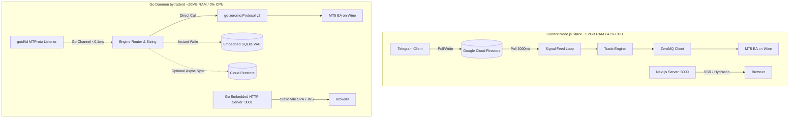
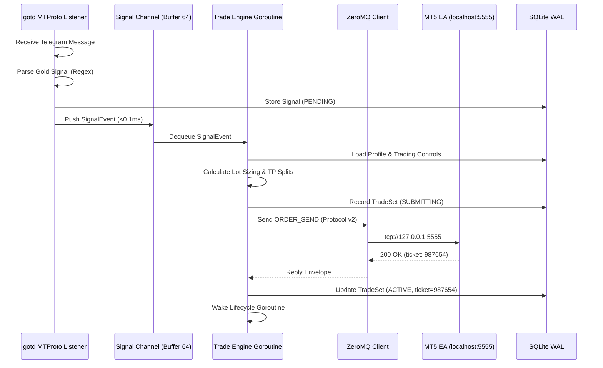

# ByTrader: Go Migration Plan & Technical Architecture

**Document Version:** 1.0.0  
**Target Architecture:** Single Standalone Go Daemon (`bytraderd`) + Embedded Vite SPA  
**Target Performance:** 0.0% Idle CPU · <25 MB RAM · <1 ms Internal Latency · Zero Cloud Quota Burn  
**Status:** Approved for Implementation  

---

## 1. Executive Summary & Migration Objectives

The current ByTrader deployment on the Linux VPS operates across two Node.js services (`bytrader-worker` and `bytrader-autotrader`) plus a Next.js 14 App Router dashboard. While functionally capable, this architecture suffers from severe efficiency and operational bottlenecks:
- Continuous Firestore polling burns 150,000+ reads/day, exhausting daily cloud quotas and causing rapid retry loops.
- Reconnection socket leaks in ZeroMQ reached 1,051 file descriptors, hitting the Linux `1024` limit (`EMFILE`) and driving CPU usage to **~47% permanently**.
- Signal entry latency is **0–3,000 ms** due to polling intervals and cloud roundtrips.
- Memory consumption across two Node runtimes and Next.js exceeds **800 MB – 1.4 GB RAM**.

### Target Architecture Goals
1. **Single Binary Deployment:** Consolidate all services into one self-contained, statically linked executable (`bytraderd`) containing the Telegram MTProto listener, trade engine, ZeroMQ bridge client, SQLite database, and embedded web dashboard.
2. **Resource Efficiency:** Near **0.0% idle CPU** (event-driven blocking on `epoll`) and **<25 MB total RSS**.
3. **Execution Latency:** Push-based signal processing using Go channels reducing signal-to-broker latency from **~2,000 ms to <1 ms**.
4. **Local-First Reliability:** Replace Google Cloud Firestore with embedded **SQLite in WAL mode**, eliminating quota limits, network latency, and external cloud dependencies.
5. **Zero Protocol Regression:** Maintain byte-for-byte protocol v2 compatibility with `mql5/VantageBridgeEA.mq5`.

---

## 2. System Architecture Comparison



---

## 3. Technology Stack & Library Selection

| Domain | Current Stack | Go Migration Choice | Rationale |
|---|---|---|---|
| **Language Runtime** | Node.js v24 (V8) | **Go 1.23+** | Low memory footprint, fast compilation, built-in concurrency primitives. |
| **Telegram MTProto** | GramJS (JS) | **`github.com/gotd/td`** | Pure Go official TL schema client; native reconnection, full user-account support. |
| **ZeroMQ MT5 Bridge** | `zeromq` (npm) | **`github.com/go-zeromq/zmq4`** | Pure Go implementation of ZeroMQ 4. No CGO required; eliminates socket FD leaks. |
| **Database** | Google Cloud Firestore | **`modernc.org/sqlite`** (WAL) | Pure Go SQLite engine. No CGO, zero cloud quota, <0.1 ms latency, single-file backup. |
| **Concurrency Model** | `setInterval` polling | **Goroutines + Channels** | Non-blocking actors, native synchronization via `select`, `context.Context` shutdown. |
| **Web Server** | Next.js 14 (SSR) | **`net/http` / `chi` + `embed.FS`** | Compiles static assets into Go binary; serves dashboard with 0 MB extra RAM. |
| **Web Frontend** | React / Next App Router | **Vite + React (Static SPA)** | Reuses existing React dashboard components without Next.js server overhead. |

---

## 4. Component Mapping & Module Parity

Every component in `worker/src/lib/` maps cleanly into idiomatic Go packages:

| Existing TypeScript Module | Target Go Package & File | Responsibilities & Invariants |
|---|---|---|
| `vipSignalParser.ts` | `internal/parser/gold.go` | Pure regex parser extracting symbol, direction, entry range, SL, and multi-TPs. |
| `executionProfile.ts` | `internal/profile/profile.go` | Optimal Report JSON validation, safety limits, execution caps, and rules. |
| `positionSizing.ts` | `internal/engine/sizing.go` | Lot calculation, contract size, margin requirement, volume step quantization. |
| `entryPolicy.ts` | `internal/engine/policy.go` | Spread verification, market session check, deviation limit, order type selection. |
| `mt5TradeEngine.ts` | `internal/engine/trade_engine.go` | Order generation, TP splitting, ticket correlation, revision management. |
| `brokerTypes.ts` | `internal/broker/types.go` | Shared broker models (`AccountInfo`, `SymbolInfo`, `BrokerPosition`, `BrokerOrder`). |
| `brokerRouter.ts` | `internal/broker/router.go` | Broker abstraction routing between MT5 and Simulated Broker. |
| `simulatedBroker.ts` | `internal/broker/simulated.go` | In-memory paper broker for testing and offline development. |
| `mt5Client.ts` | `internal/bridge/client.go` | ZeroMQ client implementing protocol v2, request ID matching, and timeout guards. |
| `bridgeHealth.ts` | `internal/bridge/health.go` | Protocol version check (`v2`), ping latency monitor, EA compatibility guard. |
| `lifecycleRules.ts` | `internal/lifecycle/rules.go` | Pure decision rules: breakeven stop move, trailing stop, partial close checkpoints. |
| `lifecycleManager.ts` | `internal/lifecycle/manager.go` | Adaptive ticker (sleeps when open trades = 0; wakes on trade creation). |
| `reconciler.ts` | `internal/reconciler/reconciler.go` | Periodic broker-state reconciliation, resolving `SUBMIT_UNKNOWN` states. |
| `executionControl.ts` | `internal/safety/control.go` | Thread-safe kill switch, close-all trigger, mode toggle (`LIVE` / `PAPER`). |
| `telegramClient.ts` | `internal/telegram/client.go` | `gotd/td` client authentication, session storage, connection recovery. |
| `telegramListener.ts` | `internal/telegram/listener.go` | Channel message handler, deduplication, event dispatching to Go channel. |
| `signalForwarding.ts` | `internal/telegram/forwarder.go` | Forwards validated signals to destination channels. |
| `adminCommands.ts` | `internal/safety/admin.go` | Local admin command processor (`close_all`, `pause`, `resume`, `reconcile`). |
| `alerts.ts`, `alertMonitor.ts` | `internal/notify/notifier.go` | Notification delivery (Telegram bot / Webhooks / System logs). |
| `tradeSetStore.ts` | `internal/store/trade_store.go` | SQLite transactional repository for `trade_sets` and `signal_events`. |
| `web/` | `web/` -> `internal/web/embedded.go` | Vite SPA built into `web/dist`, served via `//go:embed web/dist/*`. |

---

## 5. Protocol v2 & Trading Engine Invariants

To avoid regressions with `mql5/VantageBridgeEA.mq5`, the Go implementation must strictly preserve these existing rules:

1. **Protocol Envelope:**
   ```json
   {
     "v": 2,
     "request_id": "req-1729485000000-0001",
     "action": "ORDER_SEND",
     "expires_at": 1729485008,
     "symbol": "XAUUSD",
     "order_type": "BUY",
     "volume": 0.05,
     "sl": 2715.50,
     "tp": 2730.00,
     "deviation": 20,
     "comment": "bt:12345_678:tp1"
   }
   ```
2. **Ambiguous Mutating Timeout:**
   - If ZeroMQ times out on a mutating action (`ORDER_SEND`, `POSITION_MODIFY`, `CLOSE_POSITION`), the trade state must be marked `SUBMIT_UNKNOWN` or `closing`.
   - Never blindly retry a mutating call on timeout. Let the reconciler resolve it against MT5 position tickets.
3. **Target Remaining Volume for Checkpoints:**
   - Partial closes must always specify target remaining volume, never a relative close delta, preventing double-close errors on retries.
4. **Adaptive Lifecycle Sleeping:**
   - When no trades are open, the lifecycle goroutine must completely park on a channel receiver, utilizing **0.0% CPU**.

---

## 6. SQLite Database Architecture

Using SQLite in WAL mode provides instantaneous local queries and zero cloud bills.

### Schema Design (`internal/store/schema.sql`)
```sql
PRAGMA journal_mode = WAL;
PRAGMA busy_timeout = 5000;
PRAGMA synchronous = NORMAL;

CREATE TABLE IF NOT EXISTS signal_events (
    id TEXT PRIMARY KEY,
    chat_id INTEGER NOT NULL,
    message_id INTEGER NOT NULL,
    text_hash TEXT NOT NULL,
    raw_text TEXT NOT NULL,
    parsed_json TEXT,
    status TEXT NOT NULL, -- PENDING, PROCESSED, REJECTED, IGNORED
    created_at INTEGER NOT NULL,
    processed_at INTEGER
);

CREATE TABLE IF NOT EXISTS trade_sets (
    id TEXT PRIMARY KEY, -- {chatId}_{messageId}
    signal_id TEXT NOT NULL,
    symbol TEXT NOT NULL,
    direction TEXT NOT NULL,
    status TEXT NOT NULL, -- SUBMITTING, ACTIVE, CLOSED, FAILED
    profile_snapshot TEXT NOT NULL,
    created_at INTEGER NOT NULL,
    updated_at INTEGER NOT NULL,
    FOREIGN KEY(signal_id) REFERENCES signal_events(id)
);

CREATE TABLE IF NOT EXISTS trade_orders (
    ticket INTEGER PRIMARY KEY,
    trade_set_id TEXT NOT NULL,
    tp_index INTEGER NOT NULL,
    initial_volume REAL NOT NULL,
    current_volume REAL NOT NULL,
    open_price REAL NOT NULL,
    sl REAL NOT NULL,
    tp REAL NOT NULL,
    status TEXT NOT NULL, -- OPEN, CLOSED
    opened_at INTEGER NOT NULL,
    closed_at INTEGER,
    FOREIGN KEY(trade_set_id) REFERENCES trade_sets(id)
);

CREATE TABLE IF NOT EXISTS system_logs (
    id INTEGER PRIMARY KEY AUTOINCREMENT,
    level TEXT NOT NULL,
    component TEXT NOT NULL,
    event TEXT NOT NULL,
    payload TEXT,
    timestamp INTEGER NOT NULL
);

CREATE INDEX IF NOT EXISTS idx_trade_sets_status ON trade_sets(status);
CREATE INDEX IF NOT EXISTS idx_signals_created ON signal_events(created_at);
```

---

## 7. Concurrency & Pipeline Design



---

## 8. Phased Implementation Roadmap

### Phase 1: Environment & Project Scaffolding
- [ ] Install Go 1.23+ toolchain on VPS and local development environment.
- [ ] Initialize Go workspace at repo root (`go.mod` with module `github.com/bytrader/bytrader`).
- [ ] Establish directory structure:
  ```
  cmd/bytraderd/           # Entrypoint
  internal/
    broker/                # Broker interfaces, MT5 broker, simulated broker
    bridge/                # ZeroMQ client (Protocol v2)
    engine/                # Sizing, policy, trade engine
    lifecycle/             # Checkpoints, breakeven, trailing rules
    notify/                # Alerts & Telegram logger
    parser/                # Gold VIP regex parser
    profile/               # Execution profile models & validation
    reconciler/            # State reconciliation
    safety/                # Kill switch, admin commands
    store/                 # SQLite database & migrations
    telegram/              # gotd/td MTProto client
    web/                   # Embedded HTTP router & static handler
  web/                     # Client-side Vite React SPA
  ```

### Phase 2: Core Domain & Pure Logic
- [ ] Port `vipSignalParser.ts` &rarr; `internal/parser/gold.go` with 100% regex parity and golden tests.
- [ ] Port `executionProfile.ts` &rarr; `internal/profile/profile.go` including all safety limits and schema checks.
- [ ] Port `positionSizing.ts` & `entryPolicy.ts` &rarr; `internal/engine/`.
- [ ] Port `lifecycleRules.ts` &rarr; `internal/lifecycle/rules.go`.
- [ ] Verify test suite against existing TypeScript fixtures.

### Phase 3: ZeroMQ MT5 Bridge & Broker Layer
- [ ] Implement pure-Go ZeroMQ client (`internal/bridge/client.go`) using `github.com/go-zeromq/zmq4`.
- [ ] Implement single-socket reuse, request correlation, and timeout handling.
- [ ] Port `simulatedBroker.ts` &rarr; `internal/broker/simulated.go` for full offline pipeline testing without MT5.
- [ ] Port `mt5Broker.ts` &rarr; `internal/broker/mt5.go`.

### Phase 4: Local Storage (SQLite WAL) & State Management
- [ ] Implement SQLite store (`internal/store/`) using `modernc.org/sqlite`.
- [ ] Write transactional queries for `SignalEvents`, `TradeSets`, and `Orders`.
- [ ] Port `reconciler.ts` &rarr; `internal/reconciler/reconciler.go`.
- [ ] Implement adaptive lifecycle runner (`internal/lifecycle/manager.go`) that sleeps when open trades count is 0.

### Phase 5: Telegram MTProto Ingestion (`gotd/td`)
- [ ] Implement Telegram user client (`internal/telegram/client.go`) using `github.com/gotd/td`.
- [ ] Create session migrator / authenticator script to persist MTProto session data to disk.
- [ ] Implement channel message handler with message deduplication and auto-forwarding.
- [ ] Connect listener output to engine input via Go channels (`chan SignalEvent`).

### Phase 6: Web Dashboard & Embedded Assets
- [ ] Convert `web/` from Next.js to Vite + React SPA:
  - Remove Next.js routing; use lightweight hash/browser router or single dashboard view.
  - Retain Tailwind styling and Lucide icons.
  - Run `npm run build` to output `web/dist/`.
- [ ] Create Go HTTP server (`internal/web/router.go`):
  - Serve REST endpoints (`/api/health`, `/api/trades`, `/api/control`, `/api/profiles`).
  - Serve embedded frontend via `//go:embed dist/*`.

### Phase 7: Parallel Verification & VPS Deployment
- [ ] Run `bytraderd` in parallel on the VPS with `MODE=PAPER` (Simulated Broker) to verify Telegram ingestion and sizing.
- [ ] Point `bytraderd` to MT5 Demo account and execute end-to-end verification trades.
- [ ] Confirm:
  - **Memory:** Stays between 15 MB and 25 MB RSS.
  - **CPU:** Stays at 0.0% idle.
  - **File Descriptors:** Constant at ~12 FDs (zero socket leaks).
- [ ] Update systemd service (`/etc/systemd/user/bytrader.service`) to point to the single Go binary.
- [ ] Disable legacy Node.js services (`bytrader-worker` and `bytrader-autotrader`).

---

## 9. Rollback & Safety Strategy

1. **Dual Systemd Units:** Keep `bytrader-worker.service` and `bytrader-autotrader.service` installed (disabled) on the VPS during the transition.
2. **Instant Rollback:** If the Go daemon encounters any unhandled panic or network anomaly:
   ```bash
   systemctl --user stop bytrader
   systemctl --user start bytrader-worker bytrader-autotrader
   ```
3. **Database Independence:** SQLite state is local and isolated; reverting to Node.js will resume from Firestore state without database corruption.

---

## 10. Summary of Expected Operational Gains

| Metric | Current Node.js + Next.js Stack | Target Go Standalone Daemon | Impact |
|---|---|---|---|
| **Idle CPU Utilization** | ~47% (continuous loop) | **0.0%** | VPS load eliminated |
| **Idle Memory (RSS)** | ~800 MB – 1.4 GB | **~18 – 22 MB** | **>97% memory saved** |
| **Signal Entry Delay** | 1,000 – 3,000 ms (polling) | **<1 ms (push channel)** | Elimination of entry slippage |
| **Daily Cloud Reads** | 150,000+ reads (quota error) | **0 reads (local SQLite)** | Zero cloud billing / quota risk |
| **Processes to Manage** | 3 (Worker, AutoTrader, Web) | **1 Single Binary** | Vastly simplified operations |
| **Deployment Mechanism** | `npm install` + Next build on VPS | `scp bytraderd vps:` (single file) | Instant, zero-downtime deploys |
