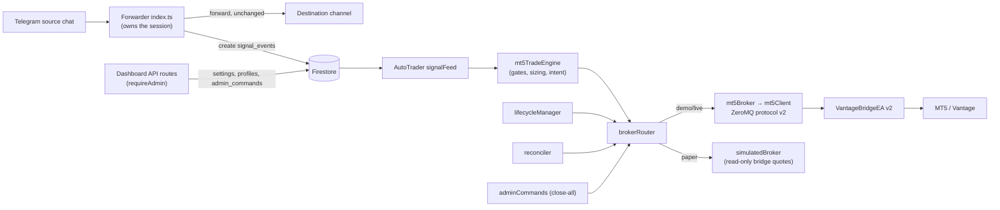
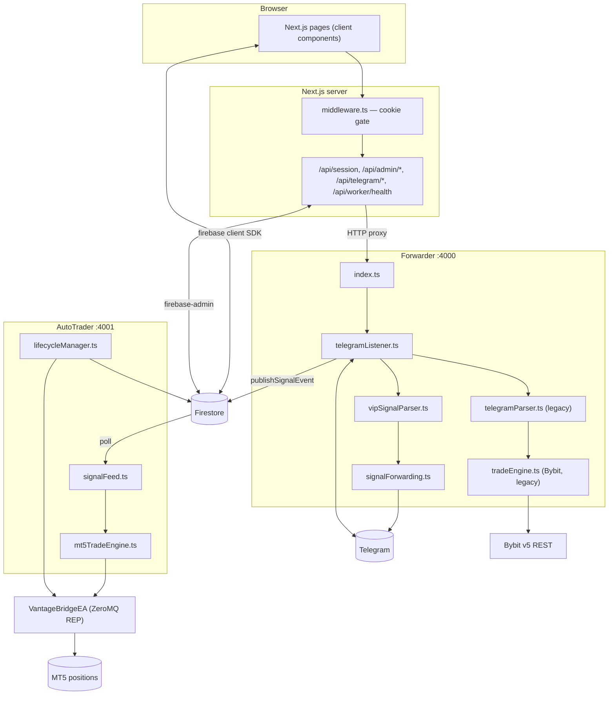
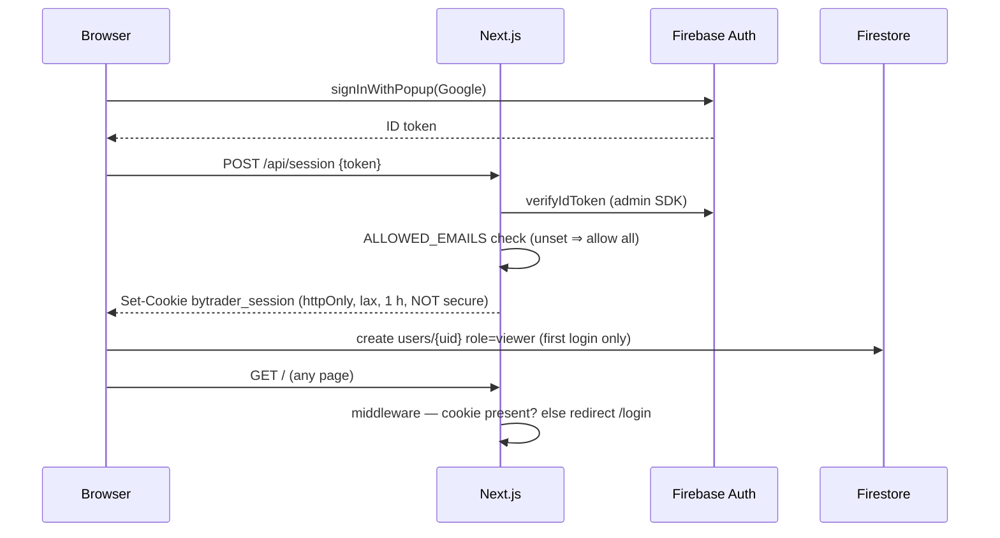

# ByTrader — Architecture

> Documents what **exists in the code**, with file/line evidence. Anything
> designed but not built is marked **[NOT IMPLEMENTED]**. Inferred behaviour is
> marked **[INFERRED]**; unverified claims are marked **[UNVERIFIED]**.
> Verified against commit `435466f`.
>
> **Update 2026-10-18:** the Vantage completion work changed the execution side.
> **§0 below describes the current implementation.** Sections 1–11 are the
> pre-change analysis of `435466f`; where they conflict with §0, §0 wins
> (superseded passages are flagged inline). Interfaces:
> `VANTAGE_DESIGN_CONTRACTS.md`; operations: `VANTAGE_EXECUTION_GUIDE.md`.
>
> **Update 2026-10-21:** the legacy Bybit engine (`tradeEngine.ts`,
> `bybitClient.ts`, `bybitSecrets.ts`, `tradeSizing.ts`, `tradingSettings.ts`,
> `bybit-api`) was **deleted**, and the Bybit-era `trading.*` settings are no
> longer read or editable. Passages below that describe them are historical.
> Current state: `CURRENT_STATE.md`; operations: `VANTAGE_EXECUTION_GUIDE.md`.

---

## 0. Current implementation (2026-10-18)



**Forwarder flow (replaces Flow A step g):** parse gold signal → forward →
`publishSignalEvent` (`create()`, retried, logged twice on failure). An edit
that no longer parses publishes `kind:'cancel'` with `cancel_reason`
`unparseable_edit` (or `explicit_cancel` when the text has cancel intent). A new
message with cancel intent that replies to a signal publishes an
`explicit_cancel` for the replied-to message id. **No broker code is reachable
from the forwarder** (Bybit call removed; static guard tests).

**AutoTrader flows:**

| Loop | Module | Interval | Does |
|---|---|---|---|
| Startup reconciliation | `reconciler.ts` | once, before the feed | Resolve leftovers from the previous run |
| Signal feed | `signalFeed.ts` | 3 s | Sequential dispatch to `handleSignalEvent`; retry queue; status on `signal_events.autotrader` |
| Engine | `mt5TradeEngine.ts` | per event | Claim `trade_sets/{chat}_{msg}` (atomic create) → gates → fresh kill-switch re-check → persist `SUBMITTING` → `placeOrder` → `OPEN` / `PENDING_ORDER` / `REJECTED` / `SUBMIT_UNKNOWN` |
| Lifecycle | `lifecycleManager.ts` | 2 s | Checkpoint partial closes, BE / trailing / after-checkpoint SL, pending fills, closes |
| Reconciler | `reconciler.ts` | 15 s | `SUBMIT_UNKNOWN` resolution by correlation comment, stale states, orphans, volume drift |
| Admin commands | `adminCommands.ts` | 3 s | `close_all` (kill switch first, owned positions only, two sweeps) |

**Firestore collections (new or changed):**

| Collection | Writer | Purpose |
|---|---|---|
| `trade_sets` (schema 2) | AutoTrader | State machine, plan, frozen `profile_snapshot`, lifecycle checkpoints, broker refs, result |
| `trade_events/{trade_set_id}__{event_key}` | AutoTrader | Idempotent audit timeline |
| `signal_events` | Forwarder (+ `autotrader` status by AutoTrader) | Hand-off; adds `cancel_reason`, `trigger_message_id` |
| `execution_profiles/{profile_id}__v{n}` | Web API | Draft / approved / active / superseded / rejected profiles |
| `execution_profile_audit`, `admin_audit` | Web API | Who changed what |
| `admin_commands` | Web API (create), AutoTrader (execute) | Close-all |
| `paper_broker/state` | AutoTrader | Simulated broker persistence |
| `settings/default.execution`, `.safety`, `.trading.kill_switch` | Web API | Mode, active profile pointer, safety limits, kill switch |

**Bridge protocol v2** (`mql5/PROTOCOL.md`): envelope `v:2`, `request_id`,
`expires_at` on mutations (EA rejects expired requests), replay cache, duplicate
guard on order comment + magic, ownership checks on every modify/close/cancel,
`OnTimer` processing, actions `PING`, `ACCOUNT_INFO`, `SYMBOL_INFO`,
`GET_POSITIONS` (with `price_current`), `GET_ORDERS`, `GET_DEALS`,
`ORDER_CHECK`, `ORDER_SEND`, `POSITION_MODIFY`, `PENDING_MODIFY`,
`CLOSE_POSITION` (partial), `CANCEL_ORDER`. The client serializes requests and
never retries mutations.

**Auth:** web mutations only through API routes guarded by `requireAdmin`
(verified ID token with revocation check, `ALLOWED_EMAILS`, `users/{uid}.role
=== 'admin'`). `firestore.rules` denies all client writes. Worker HTTP binds
127.0.0.1 by default; `/telegram/*` and `/mt5/*` need `WORKER_API_TOKEN` or
loopback.

---

## 1. System components

Four runtime pieces plus two external services.

| Component | Process | Port | Source |
|---|---|---|---|
| **Forwarder** | `node dist/index.js` | `WORKER_PORT` (default 4000) | `worker/src/index.ts` |
| **AutoTrader** | `node dist/autotrader.js` | `AUTOTRADER_PORT` (default 4001) | `worker/src/autotrader.ts` |
| **Dashboard** | Next.js server | `next dev` 3000 / compose maps 3001→3000 | `web/` |
| **MT5 bridge** | MT5 `terminal64.exe` + `VantageBridgeEA` under Wine | ZeroMQ REP `tcp://127.0.0.1:5555` | `mql5/VantageBridgeEA.mq5` |
| *Firestore* | Google Cloud | — | shared state |
| *Telegram* | MTProto | — | external |



---

## 2. Application initialization

### 2.1 Forwarder — `worker/src/index.ts`

1. `dotenv.config({ path: '../.env.local' })` then `dotenv.config()` — lines 1–6.
   The `../` is **relative to `process.cwd()`**, so this only resolves correctly
   when launched from `worker/` (which the systemd units guarantee via
   `WorkingDirectory=`).
2. Creates an Express app, `express.json()` body parsing.
3. Registers routes: `GET /health`, `GET /telegram/status`,
   `POST /telegram/{start,verify-otp,verify-password,logout}`.
4. `app.listen(port)`; logs `worker_started` to stdout and Firestore.
5. **Starts a 10-second `setInterval`** that calls `getTelegramStatus()` and, if
   authorized, calls `startTelegramListener()` (idempotent — guarded by
   `listenerStarted`). This is the self-healing mechanism for the listener.
6. `SIGTERM`/`SIGINT` → `process.exit(0)` (no explicit cleanup).

### 2.2 AutoTrader — `worker/src/autotrader.ts`

1. Same dotenv pattern.
2. Routes: `GET /health`, `GET /mt5/health`, `GET /mt5/config`.
   Note `/mt5/config` returns the resolved MT5 config, including the symbol and
   magic number, over unauthenticated HTTP.
3. **Starts both background loops immediately** on listen:
   `startSignalFeed()` and `startLifecycleManager(LIFECYCLE_INTERVAL_MS ?? 2000)`.
   There is no gate on the MT5 bridge being reachable — unlike the comment in
   `deploy/MT5_GUI.md` implies.
4. `SIGTERM`/`SIGINT` → `stopSignalFeed()`, `stopLifecycleManager()`, exit.

### 2.3 Dashboard

- `web/middleware.ts` runs on every path (`matcher: ['/:path*']`) and, for
  non-API, non-static, non-dotted paths, redirects to `/login` unless the
  `bytrader_session` cookie is present.
- Client pages are React client components that subscribe to Firestore
  (`onSnapshot`) and read `process.env.WORKER_URL`-proxied worker endpoints.
- `web/src/lib/firebaseClient.ts` initializes the client SDK **only when
  `typeof window !== 'undefined'`** and swallows failures with a
  `console.error`; every consumer therefore operates over possibly-`null`
  handles.

---

## 3. Data model (Firestore)

Collections observed in code:

| Collection / doc | Written by | Read by | Shape |
|---|---|---|---|
| `settings/default` | web (settings/admin pages), `initFirestore.js`, `bybitSecrets.ts` (merge), `telegramListener.ts` (migration merge) | worker + web | `trading{…}`, `telegram{allowed_chat_ids, blocked_chat_ids, chat_id_labels, signal_forward_enabled, forward_chat_id, signal_source_chat_ids}`, `mt5{symbol_base, symbol_suffix, magic, deviation, volume, source_chat_ids}`, `bybit{apiKeyEnc, apiSecretEnc, testnet}`, `admin_actions` |
| `telegram_messages` | `telegramListener.ts` | dashboard logs page, trades page | `chat_id, message_id, hash, type('new'\|'edit'), text, date, edit_date, parsed_ok, parsed, parse_error, debug{…}, raw_message, timestamp`; doc id `${chatId}_${messageId}_${hash}` |
| `telegram_updates_debug` | `telegramListener.ts` (`Raw` handler) | nothing in repo | Raw MTProto update dumps; **grows unbounded** |
| `signal_events` | `signalEvents.ts` | `signalFeed.ts` | `chat_id, message_id, message_type, text_hash, kind('signal'\|'cancel'), signal, message_date, created_at`; doc id `${chatId}_${messageId}_${textHash}` |
| `signal_forwards` | `signalForwarding.ts` | nothing in repo | Revision bookkeeping: `revision, correction, last_hash, text, timestamp` |
| `trade_sets` | `mt5TradeEngine.ts`, `tradeEngine.ts`, `lifecycleManager.ts` | dashboard trades/analytics pages, `lifecycleManager.ts` | see below |
| `trade_events` | **nothing** | dashboard trades page | **[NOT IMPLEMENTED]** — the UI's event timeline is always empty |
| `system_logs` | `systemLog.ts`, `initFirestore.js` | dashboard logs page | `timestamp, level, component, message, details` |
| `users/{uid}` | `web/src/lib/auth.ts` on first sign-in | `api/admin/role`, `api/admin/ping` | `uid, email, role('viewer'\|'admin'), created_at` |

### `trade_sets` — two incompatible shapes

The two engines write **different field layouts** to the same collection:

```jsonc
// mt5TradeEngine.ts (current)
{ "trade_set_id", "source_message_id", "chat_id", "symbol", "direction",
  "entry_low", "entry_high", "sl", "take_profits": [...],
  "state", "broker": "mt5", "volume",
  "mt5": { "ticket", "symbol", "entry_price", "tp1_volume", "tp2_volume", "tp3_volume" },
  "created_at", "updated_at" }

// tradeEngine.ts (legacy Bybit)
{ "trade_set_id", "source_message_id", "chat_id", "symbol", "direction",
  "entry_type": "market", "sl", "tp1", "tp2", "tp3",
  "state", "risk_amount", "qty",
  "bybit": { "entry_order_id", "sl_order_id", "tp1_order_id", "tp2_order_id",
             "tp3_order_id", "avg_entry_price" },
  "created_at", "updated_at" }
```

The dashboard's trades page reads `sl`/`take_profits`-style fields
(`web/src/app/trades/page.tsx`), so legacy rows authored by the Bybit engine
will not render consistently. **[CONFIRMED by reading both writers and the
reader]**

### Trade states observed

`DETECTED` → `ENTRY_PLACED` → `PROTECTION_PLACED`, plus terminal/intermediate
`SKIPPED` (with `skip_reason`), `ERROR`, `CANCEL_REQUESTED` → `CANCELLED`.

`SKIPPED` reasons actually emitted in code: `mt5_optional_mode`,
`signal_too_old`, `max_positions_reached` (MT5) and `bybit_not_configured`,
`signal_too_old`, `unfavorable_price`, `tp1_already_close`, `qty_below_min`,
`notional_below_min` (Bybit).

The richer state list in `engineering-spec.MD` §10 (`TP1_FILLED`,
`SL_MOVED_TO_ENTRY`, …) is **[NOT IMPLEMENTED]** — nothing writes those values.

---

## 4. Execution flows

### Flow A — Inbound Telegram message (Forwarder)

`telegramListener.ts`, handler registered by `startTelegramListener()`.

1. `NewMessage` / `EditedMessage` / `Raw` handlers registered on the GramJS
   client (`client.addEventHandler`).
2. `isInboundMessage()` drops outbound messages and messages whose sender is the
   account itself.
3. `logTelegramMessage(type, message, client)`:
   a. Resolves `chatId` (preferring `peerId.channelId` → `-100…`), `messageId`,
      `message.date`, `message.editDate`, text, and a debug envelope.
   b. Loads chat filters from `settings/default.telegram` with a 30 s TTL cache
      (`getTelegramChatFilters`) and normalizes numeric IDs into their
      `-100…` / `-…` variants.
   c. **Drops** if the chat is blocked, or if an allow-list is non-empty and the
      chat is not in it.
   d. Writes `telegram_messages/{chatId}_{messageId}_{hash}`; **skips entirely if
      the doc already exists** (this is the dedupe).
   e. Runs the **legacy parser** (`parseTelegramSignal`) and stores the result.
   f. Runs the **gold parser** (`parseGoldSignal`).
      - If it parses → `forwardGoldSignal(...)` **and** `publishSignalEvent(kind:'signal')`.
      - If it fails **and** the message is an edit → `publishSignalEvent(kind:'cancel')`.
   g. ~~If the **legacy** parser succeeded → `handleParsedSignal(...)` →
      places a real Bybit order (see Flow E).~~ **Removed 2026-10-18** — the
      legacy parse result is only recorded in `telegram_messages`.
4. `Raw` handler independently dumps every raw update into
   `telegram_updates_debug`.

> Superseded: step (g) was removed on 2026-10-18; the forwarder no longer trades.

### Flow B — Forwarding (Telegram → Telegram)

`signalForwarding.ts` → `forwardGoldSignal(sourceChatId, messageId, signal, hash)`:

1. Loads config (30 s cache): `signal_forward_enabled`, `forward_chat_id`,
   `signal_source_chat_ids`, with hardcoded fallbacks
   (`-1002350471397`, `['-1003271337051']`).
2. Returns early if disabled or the source chat is not configured.
3. Reads `signal_forwards/{sourceChatId}_{messageId}`:
   - same `last_hash` → **return false** (idempotent),
   - otherwise `revision = previous.revision + 1` → sets `correction = true`.
4. Resolves the destination entity (`getEntity`, falling back to scanning up to
   300 dialogs by stripping `-100`), sends the formatted message.
5. Persists the forward record and writes `system_logs`.

Message format (`formatSignalMessage`): `🟢 BUY` / `🔴 SELL`, symbol, blank line,
`Entry: low - high`, `SL: n`, then `TPn: n` lines, prefixed by `♻️ CORRECTION`
when revised. **`orderType` is not represented in the forwarded text.**

### Flow C — Inter-service hand-off (`signal_events`)

`signalEvents.ts` → `publishSignalEvent`:
- Doc id is `${chatId}_${messageId}_${textHash}` — **each text revision produces
  a distinct document**, so an edited signal produces a second event rather than
  overwriting the first.
- `created_at` is an **ISO-8601 string**, which is what makes the consumer's
  string-range query work.

`signalFeed.ts` (AutoTrader side):
- `startSignalFeed()` sets `_cursor = now - SIGNAL_FEED_LOOKBACK_MS` (default
  5 min) and schedules `loop()` on `setTimeout` (default 3 s).
- `tick()` runs a single-field ordered query
  `where('created_at','>',cursor).orderBy('created_at','asc').limit(100)`,
  advances the cursor per document, and dispatches each.
- If a full page (100) is returned it immediately re-loops with `setTimeout(…, 0)`.
- Per-document dispatch failures are caught, logged, and written to
  `system_logs` — **they do not stop the loop**.
- `dispatchSignalEvent` ignores events whose `chat_id` is not in
  `mt5.source_chat_ids`, then routes `kind:'signal'` → `handleGoldSignal` and
  `kind:'cancel'` → `cancelGoldTrade`.

### Flow D — MT5 execution

> Superseded by §0 (engine rewritten 2026-10-18). Kept as the `435466f` analysis.

`mt5TradeEngine.ts` → `handleGoldSignal(context)`:

1. Doc id `${chatId}_${messageId}`; **returns immediately if the doc exists**
   (idempotency).
2. Writes the `trade_sets` record with `state: 'DETECTED'` **before** any
   broker interaction.
3. `settings.mt5Optional` → `SKIPPED / mt5_optional_mode`.
4. Staleness: `now - messageDate > max_signal_delay_sec` → `SKIPPED / signal_too_old`.
5. `entryPrice = (entryLow + entryHigh) / 2`.
6. Fetches positions and filters by `magic`; `>= max_open_positions` →
   `SKIPPED / max_positions_reached`.
7. `volume = calcLots(entryPrice, sl, riskValue, mt5Config.volume)` — a **fixed
   volume from config short-circuits the risk calculation**.
8. `mt5PlaceOrder(...)` with `price: 0.0` for market orders and
   `tp: takeProfits[2]` (TP3 attached to the entry order).
9. On success → `state: 'ENTRY_PLACED'` with the `mt5{}` block, then
   `PROTECTION_PLACED`.
10. On any throw → `state: 'ERROR'` with the message.

**Explicit non-goals in this handler** (comments in the source confirm):
slippage validation is skipped, and TP1/TP2/TP3 are **not** placed as separate
orders — only the volumes are computed and stored.

### Flow E — Legacy Bybit execution (no longer invoked)

> Since 2026-10-18 nothing calls `handleParsedSignal`; the file is kept on disk (backlog A1).

`tradeEngine.ts` → `handleParsedSignal(context)`: identical idempotency and
staleness pattern, then a full implementation — ticker + kline reference price,
slippage and TP1-skip checks, instrument filters (qty step, min qty, min
notional), risk-based sizing with a 98 % safety buffer, market entry, then three
reduce-only limit TPs (60/25/15) and a reduce-only stop-market SL with
`triggerDirection` derived from the direction.

### Flow F — Position lifecycle (AutoTrader)

> Superseded by §0 (lifecycle rewritten 2026-10-18; uses `priceCurrent`, real partial closes).

`lifecycleManager.ts`, `setTimeout` loop every `LIFECYCLE_INTERVAL_MS` (2000):

Per tick: load settings + MT5 config → `mt5GetPositions(symbol)` →
`updateWatermarks()` → for each position **with a matching magic number**, run
three rules concurrently via `Promise.allSettled`:

1. **Break-even** — if the watermark has moved `be_trigger_pips` in favour and BE
   has not been applied, `ORDER_MODIFY` to entry ± `be_buffer_pips`; guarded so
   SL never moves backwards.
2. **Trailing stop** — only after BE is applied; SL = watermark ∓
   (`trail_step_pips` + `stop_buffer_pips`), again tighten-only.
3. **Cancel request** — queries `trade_sets` for
   `mt5.ticket == ticket && state == 'CANCEL_REQUESTED'`; if found, closes the
   position and sets `state: 'CANCELLED'`.

Pip conversion is **hardcoded for gold**: `XAUUSD_PIP = 0.10`
(`lifecycleManager.ts`). Any non-gold symbol will be mismanaged.

⚠️ **Correctness caveat [CONFIRMED]:** the watermark and "current price" are
derived from `pos.open_price` of the position, not from live market prices — the
`profitDist` local in `applyBreakEven` is computed and never used.
Break-even/trailing therefore depend on the position's *open* price rather than
its current price, which is unlikely to be the intended behaviour. Treat
lifecycle stop management as **unverified in production**.

### Flow G — Dashboard Telegram onboarding

`web/src/app/telegram/page.tsx` polls `/api/telegram/status` every 5 s and calls
`/api/telegram/{start,verify-otp,verify-password,logout}`, each of which proxies
straight to the worker. The worker's `telegramClient.ts` implements the flow with
promise resolvers: `client.start()` is called once, and
`phoneCode`/`password` callbacks block on promises that `submitTelegramCode` /
`submitTelegramPassword` resolve. On success the GramJS `StringSession` is saved
encrypted via `saveTelegramSession`.

---

## 5. Authentication and authorization



Facts:

- The session cookie stores the **raw Firebase ID token** as its value
  (`api/session/route.ts`).
- `middleware.ts` performs a **presence check only** — no verification, no
  expiry check.
- **All `/api/*` paths bypass the middleware**, so API routes are protected only
  by whatever each handler does itself.
- Only three routes touch the Admin SDK: `/api/session`, `/api/admin/role`,
  `/api/admin/ping`. `/api/admin/ping` is the **only** route that enforces
  `role === 'admin'`.
- **The five `/api/telegram/*` routes and `/api/worker/health` have no
  authentication at all.** Anyone able to reach the dashboard origin can read
  Telegram status, initiate a login, submit an OTP or 2FA password, and log the
  session out.
- Role-gating in the UI (`admin/page.tsx`, `settings/page.tsx`) is client-side
  only; real enforcement for Firestore writes would have to come from Firestore
  security rules. **[UNVERIFIED — no rules file exists in this repository.]**

---

## 6. The MT5 bridge protocol

> Superseded: protocol v2, see §0 and `mql5/PROTOCOL.md`. Below is the v1 analysis.

**Transport.** Node uses a single shared `zeromq` `Request` socket
(`mt5Client.ts`), with `sendTimeout`/`receiveTimeout` = `MT5_TIMEOUT_MS`
(default 5000). The EA binds a `ZMQ_REP` socket with HWM 10/10 and linger 0.

**Envelope.**

```jsonc
// Request
{ "action": "ORDER_SEND|ORDER_MODIFY|GET_POSITIONS|CLOSE_POSITION", ...fields }
// Response
{ "ok": true,  "retcode": 10009, "data": { ... } }
{ "ok": false, "retcode": 4001,  "error": "message" }
```

**Retry semantics (`mt5Send`).** Up to 2 attempts. On any non-`Mt5BridgeError`
failure the socket is **destroyed** and a fresh one is created after a 1 s pause.
A `Mt5BridgeError` (the EA answered with `ok:false`) is **not** retried and
propagates to the caller. Exhausted retries raise `Mt5TimeoutError`.
`maybeSendDisconnectAlert` logs a `system_logs` entry, throttled to one per 60 s —
**it does not actually send an alert** (the comment states the notification layer
is the caller's responsibility, and no caller exists).

**EA behaviour.** Requests are only serviced inside `OnTick` with a non-blocking
`recv`. `InpPollIntervalMs` is declared but unused. **Consequence: with no ticks
(market closed), the bridge is unresponsive and every call times out.** The
health check (`mt5HealthCheck`) issues a real `GET_POSITIONS` round trip, so
`/health` reports `mt5Bridge: "unreachable"` in those windows.

**Safety checks present in the EA:** stop-level pre-validation (`ValidateStops`)
for market and pending-limit orders; per-request magic/deviation override with
fallback to the EA inputs; symbol-suffix auto-resolution on init.

**Safety checks absent:** no magic-number or ownership check on `ORDER_MODIFY` /
`CLOSE_POSITION` (any ticket can be modified or closed); stop-level validation is
**skipped for `BUY_STOP`/`SELL_STOP`**; `ORDER_FILLING_IOC` is hardcoded; no
`ACCOUNT_TRADE_ALLOWED` / `SYMBOL_TRADE_MODE` checks; no request idempotency key.

---

## 7. State management

**Worker:** module-level mutable singletons, no persistence across restarts.
`telegramClient.ts` (status, resolvers, client), `telegramListener.ts`
(`listenerStarted`, cached chat filters), `signalFeed.ts` (`_running`, `_timer`,
`_cursor`), `lifecycleManager.ts` (`_watermark`, `_entryPriceCache`,
`_beApplied`), `mt5Client.ts` (`_socket`), `mt5Secrets.ts` /
`signalForwarding.ts` / `telegramListener.ts` (30 s config caches).

- `signalFeed`'s cursor resets to `now - lookback` on every start, which is what
  makes restart-safety work (overlap is tolerated because handlers are
  idempotent).
- `lifecycleManager`'s watermark map is **in-memory only**, so a restart resets
  trailing-stop history. Combined with the `pos.open_price`-based watermark
  (Flow F caveat), trailing behaviour after a restart is not reliable.

**Web:** no global store. Pages hold local `useState` populated from Firestore
`onSnapshot` subscriptions (dashboard, logs) or one-shot `getDocs` (analytics,
trades, admin).

---

## 8. Error handling and observability

| Mechanism | Implemented by | Behaviour |
|---|---|---|
| stdout logging | `logger.ts` | One JSON line per event: `{level, event, payload, timestamp}` |
| Firestore logging | `systemLog.ts` | `system_logs.add({timestamp, level, component, message, details})`; returns `false` on failure, never throws |
| Listener errors | `telegramListener.ts` | Caught per message → `logger.error` + `system_logs` |
| Trade errors | `mt5TradeEngine.ts` / `tradeEngine.ts` | Caught → `state: 'ERROR'` + `error` field + `system_logs` |
| Feed errors | `signalFeed.ts` | Per document and per tick, caught and logged; loop continues |
| Lifecycle errors | `lifecycleManager.ts` | Per-tick try/catch → `logger.warn`; **no `system_logs` entry** |
| MT5 transport errors | `mt5Client.ts` | Socket destroy + one retry → `Mt5TimeoutError`; throttled log |
| HTTP 5xx | both entry points | Express default handler; no centralized error middleware |
| Process crashes | `worker/scripts/run-with-backoff.sh` (Docker only) | 3 attempts, 5 s/15 s/60 s, then exit with the failing code |
| Process crashes (systemd) | `Restart=always`, `RestartSec=5` | Restarts immediately, forever |

**No metrics, tracing, or alerting.** `/health` on both services is the only
machine-readable signal, and nothing polls it in production except the dashboard
dashboard widget and the Vercel checklist.

---

## 9. Configuration loading

Two independent paths:

1. **Environment variables.** `dotenv` in both entry points, plus per-module
   `process.env` reads (see `DEVELOPMENT_GUIDE.md` §4 for the full table). The
   web app relies on Vercel/Docker injecting env vars.
2. **Firestore `settings/default`.** Read by `tradingSettings.ts` (trading
   knobs), `mt5Secrets.ts` (symbol/magic/volume/lot source chats),
   `signalForwarding.ts` (forwarding knobs), `telegramListener.ts` (chat
   allow/block lists), `bybitSecrets.ts` (encrypted API keys).

**Every Firestore-backed loader has a hardcoded fallback** and swallows errors,
so a misconfigured or unreachable Firestore silently degrades to defaults rather
than failing loudly. Defaults worth knowing:

| Setting | Default | Source |
|---|---|---|
| `riskMode` / `riskValue` | `FIXED_USDT` / `20` | `tradingSettings.ts` |
| `maxSignalDelaySec` | `120` | `tradingSettings.ts` |
| `maxOpenPositions` | `3` | `tradingSettings.ts` |
| `mt5Optional` | `false` | `tradingSettings.ts` |
| `beTriggerPips` / `beBufferPips` | `20` / `2` | `tradingSettings.ts` |
| `trailStepPips` / `stopBufferPips` | `15` / `3` | `tradingSettings.ts` |
| MT5 symbol / magic / deviation / volume | `XAUUSD` / `98801` / `20` / `0.05` | `mt5Secrets.ts` |
| MT5 source chats | `['-1003271337051']` | `mt5Secrets.ts` |
| Forward enabled / target chat | `true` / `-1002350471397` | `signalForwarding.ts` |

⚠️ **The MT5 engine's risk-based sizing is bypassed by a fixed-volume default.**
`calcLots(entry, sl, riskUsd, fixedVolume)` returns `mt5Config.volume` whenever it
is `> 0`, and `mt5Config.volume` defaults to `0.05` — so `risk_value` only takes
effect if `mt5.volume` is explicitly set to `0`. Every MT5 trade is therefore
placed at a fixed lot size (or whatever `settings/default.mt5.volume` holds), not
at the risk-derived size. **[CONFIRMED]**

---

## 10. System boundaries

| Boundary | Crossed by | Trust model |
|---|---|---|
| Browser → Next.js | HTTP, cookie | Weak: cookie presence only; `/api/telegram/*` unauthenticated |
| Next.js → Worker | HTTP over `WORKER_URL` | **No authentication whatsoever** — the worker's Express routes are open to anyone who can reach port 4000/4001 |
| Worker → Firestore | Admin SDK | Service-account credentials in env |
| Worker → Telegram | MTProto | User session file + API id/hash |
| Worker → MT5 | ZeroMQ on loopback | Implicit: local process only; the EA validates no caller identity |
| AutoTrader ← Forwarder | Firestore collection | Implicit: any writer to `signal_events` can trigger a trade |
| Dashboard → Firestore (client SDK) | Firebase client config | **Depends entirely on Firestore security rules, which are not in this repository [UNVERIFIED]** |

---

## 11. Design intent vs. reality

> Pre-change table. Reconciliation, partial TPs and the single execution path now exist (§0).

| Intent (from `engineering-spec.MD`) | Reality |
|---|---|
| Firestore as single source of truth, Bybit reconciled every 15 s | No reconciliation loop exists; Firestore and MT5 state are never compared **[NOT IMPLEMENTED]** |
| Immutable `trade_events` per state transition | Nothing writes `trade_events` **[NOT IMPLEMENTED]** |
| Kill switch + paper mode + emergency close-all | UI-only flags; no worker consumer **[NOT IMPLEMENTED]** |
| Daily loss limit, per-symbol caps, duplicate-signal window | Absent **[NOT IMPLEMENTED]** |
| 3 reduce-only TP orders + managed SL | Bybit path: yes. MT5 path: TP volumes computed/stored but only TP3 is attached to the order and only the SL is managed by the lifecycle loop |
| Notifications (Telegram/SMTP/push) | Absent **[NOT IMPLEMENTED]** |
| Multi-channel degraded modes, clock-drift guard | Absent **[NOT IMPLEMENTED]** |
| One source chat → MT5 | Implemented, plus a second, unintended execution path via the Bybit engine |
| Idempotent execution | Implemented for both engines via Firestore doc-id existence checks |
