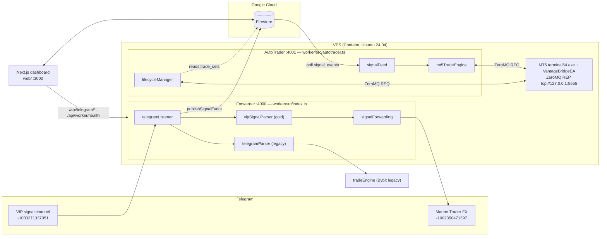

# ByTrader — Project Context

> **Status of this document:** verified against the repository at commit `435466f`
> (branch `feature/mt5-autotrader`) on 2026-10-18. Statements are marked
> **[CONFIRMED]** (read directly from source/config) or **[INFERRED]** /
> **[UNVERIFIED]** where noted.
>
> **Update 2026-10-21:** the legacy Bybit engine (`tradeEngine.ts`,
> `bybitClient.ts`, `bybitSecrets.ts`, `tradeSizing.ts`, `tradingSettings.ts`,
> `bybit-api`) was **deleted**, and the Bybit-era `trading.*` settings are no
> longer read or editable. Passages below that describe them are historical.
> Current state: `CURRENT_STATE.md`; operations: `VANTAGE_EXECUTION_GUIDE.md`.

---

## 1. What this project is

**ByTrader** (npm package name `bytrader`; originally "Marine Trader Crypto Bot";
git remote `github.com/CyGray/mt-copy-trader.git`) is a private, single-tenant
**signal-to-execution bridge with an operator dashboard**.

It does three things:

1. **Listens** to private Telegram signal channels as a *user account* (MTProto,
   not a bot), including message edits. **[CONFIRMED]**
2. **Parses** the structured signal text into trading parameters
   (symbol, direction, entry range, stop loss, take profits). **[CONFIRMED]**
3. **Executes and manages** the resulting position on a broker, and **forwards**
   the signal text to a destination Telegram channel. **[CONFIRMED]**

A Next.js dashboard provides monitoring, log inspection, settings, trade history,
and Telegram onboarding. **[CONFIRMED]**

### Two execution generations coexist in the tree

| Generation | Broker | Entry point | Status |
|---|---|---|---|
| **Legacy** | Bybit v5 Unified (USDT perps) | `worker/src/lib/tradeEngine.ts` | **[CONFIRMED]** still imported and invoked by the forwarder at runtime |
| **Current** | MetaTrader 5 via a ZeroMQ bridge EA | `worker/src/lib/mt5TradeEngine.ts` | **[CONFIRMED]** the actively developed path (branch `feature/mt5-autotrader`) |

This is the single most important thing to know before changing anything. The
legacy Bybit path was never removed — see `ARCHITECTURE.md` §6 and
`CURRENT_STATE.md` §4.

---

## 2. Primary objectives

Derived from `README.md` and `engineering-spec.MD`:

- Operate unattended for long periods ("run unattended for weeks without manual
  babysitting" — `engineering-spec.MD` §30).
- Faithfully execute a signal provider's parameters without second-guessing them
  ("The system is an **execution tool**, not a strategy engine" —
  `engineering-spec.MD` §27).
- Never double-execute a signal across restarts (idempotency;
  `engineering-spec.MD` §17).
- Keep the dashboard usable even if the trading process dies
  (`engineering-spec.MD` §2, "Separate `web` and `worker`").
- Give the operator an immediate stop control.

---

## 3. Target users

**[INFERRED]** from the deployment shape (`deploy/*.service` run as a single
Unix user, one Telegram session, one MT5 terminal, `engineering-spec.MD` §1
"Out of scope: multi-tenant"):

- **The operator** — a single trader who owns the Telegram account, the VPS, and
  the broker account. Has admin rights in the dashboard.
- **A viewer** — a read-only role that exists in the data model (`users.role`,
  `web/src/app/api/admin/role/route.ts`) and is the default assigned role.

There is no customer, tenant, or billing model anywhere in the tree.

---

## 4. Main features — as actually built

| Feature | Evidence | Notes |
|---|---|---|
| Telegram user-account login (phone → OTP → 2FA) driven from the dashboard | `worker/src/lib/telegramClient.ts`, `web/src/app/telegram/page.tsx`, `web/src/app/api/telegram/*` | **[CONFIRMED]** |
| Encrypted session persistence (AES-256-GCM, `MASTER_KEY`) | `worker/src/lib/crypto.ts`, `worker/src/lib/telegramSession.ts` | **[CONFIRMED]** |
| Message capture incl. edits, with dedupe by `chat_id + message_id + text hash` | `worker/src/lib/telegramListener.ts` (`logTelegramMessage`) | **[CONFIRMED]** |
| Two independent parsers | `worker/src/lib/telegramParser.ts` (crypto/Bybit), `worker/src/lib/vipSignalParser.ts` (XAUUSD gold) | **[CONFIRMED]** |
| Telegram → Telegram signal forwarding with correction revisions | `worker/src/lib/signalForwarding.ts` | **[CONFIRMED]** — dedupes by `last_hash`, emits `♻️ CORRECTION` on revision |
| Decoupled execution via a Firestore work queue (`signal_events`) | `worker/src/lib/signalEvents.ts`, `worker/src/lib/signalFeed.ts` | **[CONFIRMED]** |
| MT5 execution through a ZeroMQ bridge | `worker/src/lib/mt5Client.ts`, `worker/src/lib/mt5TradeEngine.ts`, `mql5/VantageBridgeEA.mq5` | **[CONFIRMED]** |
| Position lifecycle: break-even, trailing stop, cancel-on-unparseable-edit | `worker/src/lib/lifecycleManager.ts` | **[CONFIRMED]** |
| Dashboard: overview, logs, settings, trades, telegram, analytics, admin | `web/src/app/*/page.tsx` | **[CONFIRMED]**, with gaps listed in `CURRENT_STATE.md` |
| Google sign-in + role lookup + session cookie | `web/src/lib/auth.ts`, `web/src/app/api/session/route.ts`, `web/middleware.ts` | **[CONFIRMED]** |

### Documented but **not implemented** in code

These appear in `README.md` / `engineering-spec.MD` but have **zero code
references** (verified by repository-wide search):

- **Notifications**: SMTP e-mail, Web Push/VAPID, Telegram DM alerts. `SMTP_*`
  and `VAPID_*` exist only in `.env.example`; the strings appear only in
  `README.md`, `engineering-spec.MD`, `implementation-plan.MD`.
- **Kill switch / paper mode**: written by the dashboard to
  `settings/default.trading.kill_switch` and `…paper_mode`, but **no worker code
  reads either field**. The only execution gate the worker honours is
  `trading.mt5_optional` (`worker/src/lib/tradingSettings.ts` →
  `mt5TradeEngine.ts`).
- **Emergency close-all**: the admin page writes a marker
  (`web/src/app/admin/page.tsx:77-78`) that nothing consumes.
- **Trade event timeline**: `trade_events` is read by the dashboard but is
  **never written by the worker**.
- **Daily loss limits, per-symbol position caps, reconciliation loop, state
  machine, duplicate-signal window, clock-drift guard** (spec §10, §11, §21–26):
  no implementation found.

---

## 5. Technology stack

| Layer | Technology | Version | Purpose | Evidence | State |
|---|---|---|---|---|---|
| Runtime | Node.js | `>=20` declared | Both services | `package.json` `engines`; CI pins `node-version: 20` | Configured. Build machine observed running v24.20.0 |
| Package manager | npm workspaces | npm 11.19.0 observed | Monorepo | `package.json` `workspaces: ["web","worker"]` | Configured. Single `package-lock.json` at root |
| Language | TypeScript | 5.5.4 (both workspaces) | All app code | `web/package.json`, `worker/package.json` | Configured |
| Frontend | Next.js App Router | 14.2.35 | Dashboard + proxy API routes | `web/package.json` | Configured |
| Frontend | React / react-dom | 18.3.1 | UI | `web/package.json` | Configured |
| Styling | Tailwind CSS + PostCSS/autoprefixer | 3.4.6 / 8.4.40 / 10.4.20 | UI | `web/tailwind.config.ts`, `web/postcss.config.js` | Configured |
| Icons | lucide-react | ^0.563.0 | UI icons | both `package.json` | Configured |
| DB / auth | Google Cloud Firestore + Firebase Auth | `firebase` 10.14.1 (client), `firebase-admin` 12.1.1 (server) | Single source of truth | `web/src/lib/firebase{Client,Admin}.ts`, `worker/src/lib/firestoreAdmin.ts` | Configured |
| Telegram | `telegram` (GramJS) | 2.24.5 | MTProto user session, listener, send | `worker/package.json` | Configured |
| Broker (legacy) | `bybit-api` | ^4.5.1 | Bybit v5 REST | `worker/src/lib/bybitClient.ts` | Installed **and still wired at runtime** |
| Broker (current) | MT5 + ZeroMQ | `zeromq` ^6.8.0 | REQ/REP to the EA | `worker/src/lib/mt5Client.ts` | Configured |
| Bridge EA | MQL5 + CTrade + JAson + mql5-zmq | build-5100 compat fork | Executes orders inside MT5 | `mql5/VantageBridgeEA.mq5` | Source present; **third-party includes are NOT in the repo** |
| HTTP | Express | 4.22.1 | Health + Telegram control endpoints | `worker/src/index.ts`, `worker/src/autotrader.ts` | Configured |
| Config | dotenv | 16.4.5 | `.env.local` / `.env` loading | both entry points | Configured |
| Tests | Vitest | 2.1.9 | Worker unit tests | `worker/package.json` `"test": "vitest run"` | Configured, **no config file** — relies on Vitest defaults |
| Lint | ESLint | 8.57.0 + `next/core-web-vitals` (web), `@typescript-eslint` 7.18.0 (worker) | Lint | `web/.eslintrc.cjs`, `worker/.eslintrc.cjs` | Configured |
| Lint (root) | ESLint | — | Root `.eslintrc.cjs` exists | `.eslintrc.cjs` | **[UNVERIFIED]** — no root lint script invokes it; no root `eslint` dependency is declared |
| Formatting | Prettier | — | `{singleQuote, semi, trailingComma:"all"}` | `.prettierrc` | **Reference only** — prettier is not a declared dependency and no script runs it |
| Containers | Docker + Docker Compose | compose v3.9 syntax | `web` + `worker` | `docker-compose.yml`, `web/Dockerfile`, `worker/Dockerfile` | Configured (built with `npm install`, not `npm ci`) |
| CI | GitHub Actions | `ubuntu-latest`, node 20 | lint → build → test | `.github/workflows/ci.yml` | Configured. **Trigger is `branches: ["main"]` — the repo's default branch is `master`** |
| Process supervision | systemd (user units) | — | Runs compiled `dist/*.js` on the VPS | `deploy/*.service`, `deploy/install-services.sh` | Configured for the deployment host only |
| Desktop/VM | Wine 9.0 + Xvfb + x11vnc + noVNC | — | Headless MT5 GUI | `deploy/mt5-gui.sh`, `deploy/mt5-preview.sh`, `deploy/MT5_GUI.md` | Configured on the VPS; **not reproducible from this repo alone** |

---

## 6. High-level architecture

Two long-running Node processes share a Firestore database and communicate
through a Firestore collection rather than over HTTP.

**[CONFIRMED]** — every edge above is traceable to an import or a query in the
files named. See `ARCHITECTURE.md` for the same picture in text with line-level
evidence.

---

## 7. Major subsystems

| Subsystem | Location | Responsibility |
|---|---|---|
| Telegram session & auth | `worker/src/lib/telegramClient.ts`, `telegramSession.ts`, `crypto.ts` | Login state machine, encrypted session file, logout |
| Telegram listener | `worker/src/lib/telegramListener.ts` | Event handlers, chat allow/block filtering, dedupe, Firestore logging, dispatch |
| Parsers | `worker/src/lib/{telegramParser,vipSignalParser}.ts` | Two independent grammars (legacy crypto / gold) |
| Forwarding | `worker/src/lib/signalForwarding.ts` | Telegram→Telegram repost with revision/correction handling |
| Inter-service queue | `worker/src/lib/signalEvents.ts` (produce), `signalFeed.ts` (consume) | Decouples forwarder from execution |
| MT5 execution | `worker/src/lib/mt5TradeEngine.ts` + `mt5Client.ts` | Signal → order, lot sizing, trade_sets persistence |
| Lifecycle | `worker/src/lib/lifecycleManager.ts` | Break-even, trailing stop, cancel requests |
| Legacy Bybit execution | `worker/src/lib/tradeEngine.ts` + `bybitClient.ts` + `bybitSecrets.ts` + `tradeSizing.ts` | Full entry/SL/TP ladder on Bybit |
| Settings | `worker/src/lib/{tradingSettings,mt5Secrets}.ts` | Firestore-backed config with TTL caches and hardcoded defaults |
| Logging | `worker/src/lib/logger.ts` (stdout JSON), `systemLog.ts` (Firestore) | Dual-sink observability |
| Dashboard shell | `web/src/components/layouts/DashboardLayout.tsx` (+ legacy `DashboardShell.tsx`) | Navigation and auth redirect |
| Dashboard auth | `web/src/lib/{auth,useAuth,firebaseAdmin,firebaseClient}.ts`, `api/session/route.ts`, `middleware.ts` | Google sign-in → session cookie → route gate |
| Worker proxy | `web/src/app/api/telegram/*`, `web/src/app/api/worker/health` | Browser → worker HTTP relay |

---

## 8. Important external integrations

| Integration | Direction | Auth | Notes |
|---|---|---|---|
| Telegram MTProto | outbound + inbound | `TELEGRAM_API_ID`/`HASH` + user session | **Only one process may hold the session** — the forwarder. See `deploy/SERVICES.md` |
| Firestore | read/write | service-account credentials | De-facto message bus + settings store + audit log |
| Bybit v5 REST | outbound | API key/secret (Firestore-encrypted or env) | Legacy path, still invoked |
| MetaTrader 5 (via EA) | outbound over loopback ZeroMQ | none (loopback only) | `tcp://127.0.0.1:5555` |
| Google OAuth (Firebase Auth) | browser | public config | Dashboard sign-in |
| SMTP / Web Push | **not implemented** | — | Declared in `.env.example` only |

---

## 9. Current development phase

The project is **mid-migration from Bybit to MT5**, on branch
`feature/mt5-autotrader`, with the most recent commits (2026-09-24) adding the
VPS MT5 GUI and splitting the worker into two services.

- `README.md` describes the **Bybit-generation** system end-to-end and is now
  **out of date** with respect to execution.
- `implementation-plan.MD` tracks 12 phases; its own progress log marks Phases
  1–4 and 8 complete and **5, 6, 7, 9, 10, 11, 12 outstanding** — even though
  Phase 5/8 code plainly exists. Treat that file's checkboxes as stale, not as
  a source of truth.
- `engineering-spec.MD` remains the authoritative statement of **intent**.
- `deploy/SERVICES.md` and `deploy/MT5_GUI.md` are the most accurate current
  operational documents.

See `CURRENT_STATE.md` for the feature-by-feature breakdown.

---

## 10. Known constraints

1. **One Telegram session, one process.** The AutoTrader deliberately never
   connects to Telegram (`worker/src/autotrader.ts` header comment;
   `deploy/SERVICES.md`).
2. **Firestore is the only shared state.** No Redis, no queue, no IPC — the
   queue is a collection polled every 3 s (`signalFeed.ts`).
3. **The MT5 bridge is loopback-only and tick-driven.** The EA services requests
   inside `OnTick`; with no ticks (market closed) requests time out. See
   `ARCHITECTURE.md` §7.
4. **The MT5 toolchain is not reproducible from the repo.** `JAson.mqh` and the
   `Zmq` includes must be fetched manually (`mql5/SETUP_INSTRUCTIONS.txt`), and
   Wine/Xvfb/x11vnc/noVNC are host-level installs.
5. **Secrets live in `.env` / `.env.local`** (git-ignored) and in Firestore
   (encrypted with `MASTER_KEY`). Losing `MASTER_KEY` makes stored Bybit
   credentials and the Telegram session unrecoverable.
6. **`worker/src/lib/telegramSession.ts` resolves its path from `process.cwd()`**,
   so the same logical session lands in different files depending on the working
   directory. Two session files are present in the tree (`.data/` — ignored — and
   `worker/worker/data/` — **tracked in git**).

---

## 11. Important architectural decisions (and their evidence)

| Decision | Rationale (as documented) | Evidence | Still valid? |
|---|---|---|---|
| Split forwarder and AutoTrader into two processes | Restart either without disturbing the other; only one may hold the Telegram session | `deploy/SERVICES.md`, commit `4ebc1f3` | **Yes** — current design |
| Use Firestore as the inter-service queue | Avoid new infra (spec §1 "no Redis/queue") | `worker/src/lib/signalEvents.ts` header comment | Yes |
| Deduplicate by document id `${chatId}_${messageId}_${hash}` | Idempotency across restarts | `signalEvents.ts`, `telegramListener.ts` | Yes |
| Poll `signal_events` by `created_at > cursor` | Avoids a composite index | `signalFeed.ts` header comment | Yes |
| Encrypt secrets at rest with AES-256-GCM + `MASTER_KEY` | spec §13 | `worker/src/lib/crypto.ts` | Yes |
| Keep the EA thin: MT5 does orders, Node does policy | Low-latency loopback; policy changes need no EA recompile | `deploy/MT5_GUI.md`, `mt5Client.ts` | Yes |
| Ship both web and worker from one npm workspace | Unified TypeScript stack (spec §3) | `package.json` | Yes |
| Keep `tradeEngine.ts` (Bybit) rather than delete it | Not documented anywhere | `telegramListener.ts` still imports it | **Ambiguous** — no evidence of a deliberate decision; see `PLANNING_BACKLOG.md` |

---

## 12. Documentation map

| Document | Purpose |
|---|---|
| `README.md` | Public-facing overview — **describes the Bybit generation** |
| `engineering-spec.MD` | Authoritative requirements/intent (v1) |
| `implementation-plan.MD` | Phase-by-phase plan; checkboxes partly stale |
| `deploy/SERVICES.md` | **Most accurate** description of the two-service split |
| `deploy/MT5_GUI.md` | MT5/Wine/VNC install state and how to reach the GUI |
| `UI.MD` | UI/UX design system and redesign prompt (1081 lines) |
| `DEPLOYMENT.md` | Docker redeploy steps for the Hetzner/Contabo box |
| `guide.MD` | Local-only testing walkthrough |
| `pipeline.MD` | CI description |
| `vercel.MD` | Vercel deployment checklist |
| `TESTING.md` | Test Telegram account reference |
| `TELEGRAM_CHATS.md` | Chat IDs for source/destination/blocked lists |
| **`docs/project_memory/PROJECT_CONTEXT.md`** | ← this file |
| `docs/project_memory/REPOSITORY_MAP.md` | Where everything lives |
| `docs/project_memory/ARCHITECTURE.md` | How it actually works, with evidence |
| `docs/project_memory/CURRENT_STATE.md` | What is done vs. not |
| `docs/project_memory/DEVELOPMENT_GUIDE.md` | How to run and extend it |
| `docs/project_memory/PLANNING_BACKLOG.md` | Outstanding work and suggestions |
| `/AGENTS.md` | Orientation for AI coding agents |
