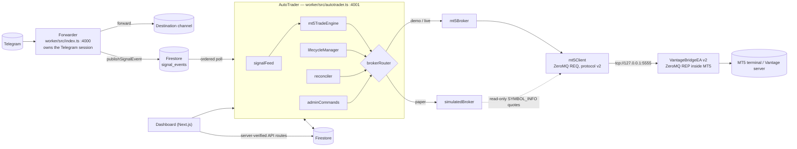
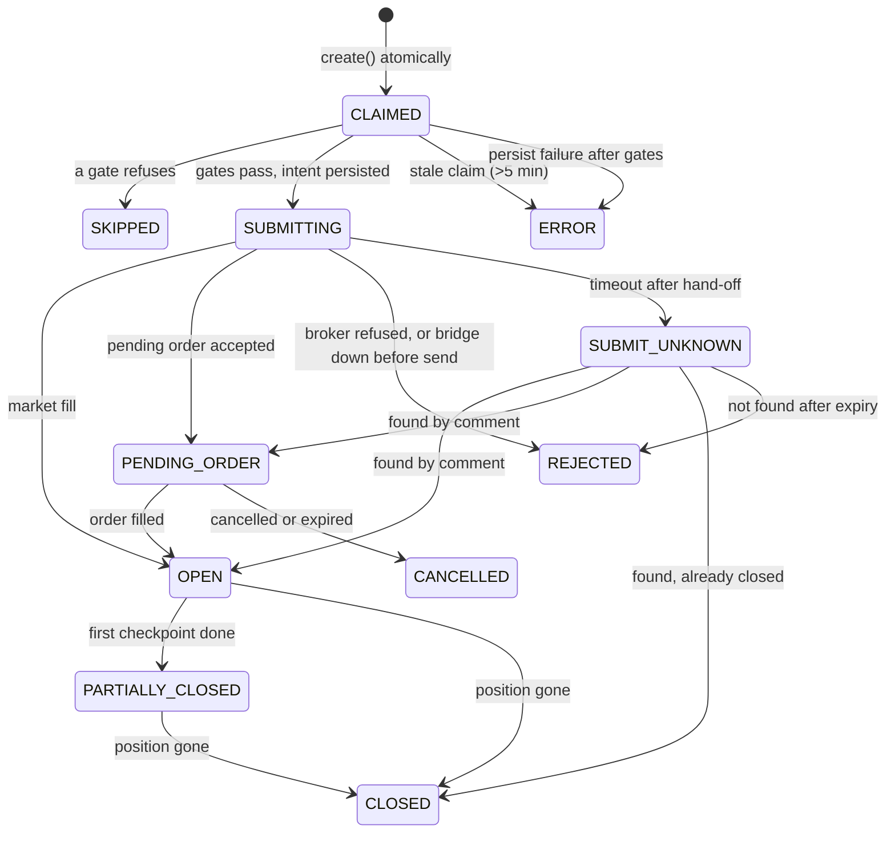

# Vantage AutoTrader — Operator Guide

> Status as of 2026-10-21 (branch `feature/mt5-autotrader`, based on `435466f`,
> uncommitted), after the hardening pass (durable signal queue, operator alerts,
> web and rules tests, paper-mode hardening, broker-assumption safeguards,
> deployment scripts, Bybit removal). **Everything was verified offline** (unit,
> end-to-end and web route tests with a simulated broker and fake Firestore;
> Firestore rules against the local emulator; type-check, lint, EA compile).
> **Nothing has been verified against Vantage or MT5.** No order has ever been
> sent through protocol v2, there has been no demo run, the Firestore rules and
> indexes are not deployed, and the Docker images have not been built. Do not
> describe this system as production-ready or broker-verified.
>
> Broker assumptions and what each one needs as evidence:
> `VANTAGE_BROKER_ASSUMPTIONS.md`.
>
> Test evidence: `VANTAGE_TEST_REPORT.md`. Known gaps: `CURRENT_STATE.md` and
> `PLANNING_BACKLOG.md`.

---

## 1. Architecture



| Piece | Role | Source |
|---|---|---|
| Forwarder | Only process that holds the Telegram session. Forwards signals and publishes `signal_events`. Never trades. | `worker/src/index.ts`, `worker/src/lib/telegramListener.ts` |
| AutoTrader | Consumes `signal_events`, runs gates, sends orders, manages open trades, reconciles, runs close-all. | `worker/src/autotrader.ts`, `worker/src/lib/*` (see `REPOSITORY_MAP.md`) |
| VantageBridgeEA v2 | Thin ZeroMQ REP bridge. Owns order mechanics and the broker-side ownership checks. | `mql5/VantageBridgeEA.mq5`, `mql5/PROTOCOL.md` |
| Firestore | The only shared state. Config, trade sets, events, profiles, commands. | `docs/project_memory/ARCHITECTURE.md` section 3 |
| Dashboard | Operator controls. Every mutation goes through a server-verified API route. | `web/src/app/api/**`, `web/src/lib/serverAuth.ts` |

**Paper mode** uses `simulatedBroker` in place of `mt5Broker`. Quotes and symbol
specs still come from the EA through read-only `SYMBOL_INFO`, so paper mode needs
the EA attached to a chart. No paper order reaches MT5.

**Legacy Bybit code** was deleted on 2026-10-21 (`tradeEngine.ts`, `bybitClient.ts`,
`bybitSecrets.ts`, `tradeSizing.ts`, `tradingSettings.ts`, and the `bybit-api`
dependency). The Telegram path still uses `telegramParser.ts` to store a diagnostic
`parsed` field in the message history; it never executes anything. The **running v1
build** on the host still contains the Bybit path until v2 is deployed (§17).

---

## 2. Execution modes

`settings/default.execution.mode` is read on every entry decision. Missing or
unknown values mean `disabled`.

| Mode | Where orders go | Account check | Entries allowed when | Confirmation to set (dashboard) |
|---|---|---|---|---|
| `disabled` | Nowhere | — | Never | none |
| `paper` | `simulatedBroker`, state in `paper_broker/state` (starts at 10 000 USD) | Informational only | Kill switch off, an active profile is valid, safety is valid | none |
| `demo` | `mt5Broker` → EA → MT5 | `ACCOUNT_INFO.trade_mode` must be `DEMO` | Same, plus the account trade flags below | typed `ENABLE DEMO TRADING` |
| `live` | `mt5Broker` → EA → MT5 | `trade_mode` must be `REAL` **and** `BYTRADER_LIVE_TRADING=enabled` in the AutoTrader environment | Same, plus the account trade flags below | typed `ENABLE LIVE TRADING` |

- Account trade flags: `trade_allowed`, `trade_expert` and `terminal_trade_allowed`
  must all be true (`brokerRouter.ts` → `verifyAccountForMode`). Otherwise the
  check fails with `trading_not_allowed`.
- The account read is cached for 30 s. The mode rules and the environment flag are
  checked on every call, so a change to `BYTRADER_LIVE_TRADING` takes effect at the
  next entry after a restart of the AutoTrader (the env is read from the process).
- Without the environment flag, `live` fails closed in two places:
  `canOpenNewEntries` returns `live_not_enabled`, and `verifyAccountForMode` returns
  `live_env_not_enabled`.
- The dashboard's mode route accepts `paper` without confirmation. Any change to
  `demo` or `live` needs the exact typed text (`web/src/app/api/execution/mode/route.ts`).
  The worker enforces the account and environment rules separately, so a dashboard
  mistake cannot place a live order on a demo account.

**[VERIFIED OFFLINE]** the mode gates (`brokerRouter.test.ts`,
`executionControl.test.ts`, `mt5TradeEngine.test.ts` gate tests).
**[UNVERIFIED: VANTAGE]** the `ACCOUNT_INFO` values on a real Vantage account.

---

## 3. Kill switch

- Stored as `settings/default.trading.kill_switch` (boolean). A malformed value
  (anything but `true` or `false`) counts as engaged.
- Engage or release from the **Admin** page or the **Settings** page. Both call
  `POST /api/execution/kill-switch` with `{ "engaged": true | false }`. No typed
  confirmation is required. The route writes an `admin_audit` entry.
- **Engaged** blocks:
  - new signals (`canOpenNewEntries` → `kill_switch`),
  - pending order placement (same path),
  - a second check right before the intent is written, using a fresh read of
    execution control. This covers a kill switch engaged while the gates are running
    (`entryRecheck` in `mt5TradeEngine.ts`).
- **Engaged does not stop**:
  - TP checkpoint closes, stop-loss management, or reconciliation of open trades,
  - revisions to open trades,
  - an explicit cancel that closes an open position (see section 11).
- A skipped signal stays `SKIPPED`. Releasing the switch does not replay it,
  because the trade set already exists and the feed treats it as processed.

**[VERIFIED OFFLINE]** `mt5TradeEngine.test.ts` (kill switch gate, re-check before
send), `mt5TradeEngine.revision.test.ts` (management continues), `pipeline.e2e.test.ts`
scenario 5.

---

## 4. Close-all

Close-all is an emergency flatten of **what this system owns**. It is not a
broker-wide flatten.

1. The operator types `CLOSE ALL` on the Admin page. The web route
   (`POST /api/admin/close-all`) writes an `admin_commands` document with
   `status: pending`.
2. The AutoTrader polls `admin_commands` every 3 s and claims a pending command in a
   transaction (`pending` → `running`). Each command runs once even with several
   pollers.
3. Validation: the confirmation must be exactly `CLOSE ALL`, and `requested_at` must
   be no older than 5 minutes. Otherwise the command is `rejected` (`confirm_mismatch`,
   `expired`).
4. **Kill switch first.** `trading.kill_switch` is set to true. If that write fails,
   the command finishes `failed` with `kill_switch_not_engaged` and nothing is closed.
5. **Sweep 1.** For each broker in use (paper always, demo and live when they are the
   current mode or have open work):
   - cancel pending orders with the EA magic,
   - fully close positions with the EA magic.
   Each result is recorded per ticket.
6. In-flight entries (`SUBMITTING`, `SUBMIT_UNKNOWN`) are flagged with
   `close_requested_by: close_all`. The reconciler closes them if they later resolve
   to an open position or pending order.
7. **Settle for 10 s.** This is longer than the 8 s request lifetime, so requests sent
   before the kill switch have either executed or expired at the EA.
8. **Sweep 2.** Positions and orders are listed again, which catches anything that
   appeared in the meantime. Trade sets are marked `close_reason: close_all`.
9. The command finishes `done` if no failure remains after sweep 2, or `failed`
   with the per-ticket results. A failure in sweep 1 that sweep 2 clears is recorded
   but not counted.

**Ownership:** close-all only touches positions and orders whose magic equals the
broker's EA magic (`settings/default.mt5.magic`, default `98801`). Manual trades and
other EAs are untouched (`adminCommands.test.ts`, "a foreign-magic position on the
same account survives").

**Caveat:** an EA-magic position that no trade set references (an orphan) is closed
by close-all. Outside close-all, the reconciler only logs orphans and never touches
them.

**Where to see the result:** `GET /api/admin/close-all?id=<id>`, the `admin_commands`
document's `result`, and `system_logs` events `close_all_started`,
`close_all_settling`, `close_all_finished`.

**[VERIFIED OFFLINE]** `adminCommands.test.ts` (18 tests) and `pipeline.e2e.test.ts`
scenario 10. **[UNVERIFIED: VANTAGE]** closing real positions.

---

## 5. Safety limits and hard ceilings

Two layers, and the effective limit on each axis is the **minimum** of the two:

- **Profile limits** (`profile.limits`, `profile.sizing`, `profile.stop_loss`, ...),
  which belong to one approved profile.
- **Safety limits** (`settings/default.safety`), which apply to every profile.

Any value above a **hard ceiling** in code is a validation error that names the field,
the submitted value and the limit. Values are never clamped silently. A missing
`settings.safety` uses the conservative defaults, but an invalid `settings.safety`
blocks entries.

| Limit | Hard ceiling (code) | Default when `settings.safety` is absent | Checked by |
|---|---|---|---|
| Risk per trade, % of equity | 5 | 1 | Sizing (`risk_percent`, `equity_risk_percent`) |
| Risk per trade, money | 5000 | 50 | Sizing (`fixed_risk_money`, cap) |
| Lots per trade | 20 | 1 | Sizing (`fixed_lots` must not exceed it: `volume_exceeds_max`) |
| Concurrent positions and pending orders | 20 | 3 | Entry gate (`max_concurrent_positions`) |
| Positions per symbol | 10 | 1 | Entry gate (`max_positions_per_symbol`) |
| Daily realized loss, money | 20 000 | 100 | Entry gate (`daily_loss_limit`, UTC day, exit deals only) |
| Total open risk, % of equity | 20 | 3 | Entry gate (`total_risk_limit`) |
| Max spread, price units | 10 | 0.5 | Entry gate (`spread_too_wide`) |
| Max deviation, points | 500 | 30 | Passed to the EA as slippage |
| Max signal age, seconds | 3600 | 120 | Entry gate (`signal_too_old`) |
| Min margin level after the trade, % | 10 000 | 200 | Entry gate (`margin_level_too_low`; `0` disables) |
| Allowed signal symbols | — | `["XAUUSD"]` | Entry gate (`symbol_not_allowed`) |

Price distances are in **price units** (for example `2.5` is 2.5 USD on XAUUSD), never
pips. The EA reports spread in points and the engine converts it using `point`.

Runtime checks:
- Gates run in the order listed in `mt5TradeEngine.ts` (`runGates`). The first refusal
  records `SKIPPED` with a stable `skip_reason`.
- The total open risk check sums `plan.risk_money` across open, pending and in-flight
  trade sets whose break-even has not applied, then adds the new trade.
- The margin check calls the broker's `OrderCheck` (`checkOrder`) before any intent is
  written.

**[VERIFIED OFFLINE]** `executionProfile.test.ts` (64), `positionSizing.test.ts` (46),
`mt5TradeEngine.test.ts` gate tests.

---

## 6. Execution profile workflow

A profile is the Optimal Report target. Its schema is in `OPTIMAL_REPORT_SCHEMA.md`.
The example is `docs/project_memory/examples/optimal_report_profile.example.json`.

| Step | Dashboard action | API | Result |
|---|---|---|---|
| 1. Draft | Create | `POST /api/profiles` (server assigns `version`) | `execution_profiles/{profile_id}__v{n}`, `status: draft` |
| 2. Edit | Edit draft | `PUT /api/profiles/[docId]` | Only `draft` can be edited |
| 3. Validate and preview | Validate | `POST /api/profiles/validate` | Validation issues plus an execution preview. Writes nothing. |
| 4. Approve | Approve | `POST /api/profiles/[docId]/approve` | `draft` → `approved`. Refused (422) unless the profile validates against the current safety limits. |
| 5. Activate | Activate | `POST /api/profiles/[docId]/activate` with `{"confirm":"ACTIVATE <docId>"}` | `approved` or `superseded` → `active`. The previous active profile becomes `superseded`. Sets `settings/default.execution.active_profile_doc_id`. |
| 6. Roll back | Roll back | `POST /api/profiles/rollback` with optional `{"docId"}` | `superseded` → `active`. Without `docId`, the most recently activated superseded version. The UI asks for a second confirmation; the API takes no typed text. |
| Reject | Reject | `POST /api/profiles/[docId]/reject` | `draft` → `rejected` |

Every action writes `execution_profile_audit` (who, what, when, previous active id).

Rules that matter in operation:

- **Snapshot per trade.** A trade set stores its profile in `profile_snapshot` at entry.
  Revisions and cancels use that snapshot, not the active profile. A later activation
  never changes an open trade.
- **Runtime re-validation, fail closed.** `executionControl` re-validates the active
  profile every time it reloads (cache TTL 5 s) against the current safety limits.
  A profile that no longer passes becomes `activeProfile: null` with a reason, and
  entries stop (`invalid_profile`). Open trades keep being managed.
- **Changing a profile never resizes or re-plans an open trade.** Only pending
  orders can be edited (section 11), and only when the profile allows it.

**[VERIFIED OFFLINE]** `executionControl.test.ts` (active profile cases),
`executionProfile.test.ts`, `mt5TradeEngine.revision.test.ts` (snapshot used, not the
active profile). The web routes have no tests (`PLANNING_BACKLOG.md`, A12).

---

## 7. Starting the services

### Production (VPS)

Both services run as **systemd user units** (`systemctl --user`). The units that
actually run are the installed copies in `~/.config/systemd/user/`. The repo copies
in `deploy/` are not installed automatically. See section 17 for the current drift.

```bash
systemctl --user is-active bytrader-worker.service bytrader-autotrader.service
curl -s localhost:4000/health   # forwarder
curl -s localhost:4001/health   # AutoTrader: firestore, bridge, execution state, loops
```

Restarting one service does not affect the other. Both run from `worker/dist/`, which
is a shared build output. Follow the safe swap procedure in section 17.

### Development

| Command | Starts | Notes |
|---|---|---|
| `npm run dev` | Web on `:3000` and forwarder on `:4000` | Does **not** start the AutoTrader |
| `npm run dev:autotrader` | AutoTrader from `worker/src/autotrader.ts` with reload | Reads `../.env.local` because the workspace runs in `worker/` |

Do not run a dev AutoTrader against the same Firestore project and MT5 account as the
production AutoTrader. Both consume `signal_events`, and both can drive the broker.

### Host binding and token

- `WORKER_HOST` (forwarder) and `AUTOTRADER_HOST` (AutoTrader) default to `127.0.0.1`.
  The AutoTrader now passes `AUTOTRADER_HOST` to `listen`.
- `WORKER_API_TOKEN` protects `/telegram/*` on the forwarder and `/mt5/*` on the
  AutoTrader. When unset, only loopback callers are allowed and others get `403`.
  When set, the request must carry `Authorization: Bearer <token>` or it gets `401`.
- **Set the same token in the web process as well.** The dashboard proxies
  `/telegram/*` and `/api/worker/health` with `workerHeaders()` in
  `web/src/lib/workerApi.ts`, which reads `WORKER_API_TOKEN`. Without it, the
  Telegram page gets `401` after the token is set on the worker.
- `EnvironmentFile=` overrides `Environment=` in systemd. Do not set `WORKER_HOST` or
  `AUTOTRADER_HOST` in `.env.local`.

Never print or commit the token. Generate it with `openssl rand -hex 32`.

---

## 8. Trade state machine

Stored in `trade_sets/{chatId}_{messageId}` (`state`, schema 2). Terminal states are
`SKIPPED`, `CLOSED`, `CANCELLED`, `REJECTED` and `ERROR`.



| State | Meaning | What the operator does |
|---|---|---|
| `CLAIMED` | Document created, gates running. Nothing sent. | None. A stale claim older than 5 min becomes `ERROR`. |
| `SKIPPED` | A gate refused. `skip_reason` holds the code (section 13). | Read `skip_reason`. Nothing was sent. Releasing the kill switch does not replay it. |
| `SUBMITTING` | Intent persisted (plan, snapshot, checkpoints). `ORDER_SEND` is in flight, or the process died mid-send. | Normally transient. Older than 120 s, the reconciler moves it to `SUBMIT_UNKNOWN`. |
| `SUBMIT_UNKNOWN` | The send outcome is ambiguous. **Never resent.** | Wait for the reconciler. It resolves after `expires_at + 5 s` by correlation comment. |
| `PENDING_ORDER` | Pending order resting at the broker. | Edits and cancels per section 11. |
| `OPEN` | Position open. No checkpoint done. | Managed by the lifecycle loop. |
| `PARTIALLY_CLOSED` | At least one checkpoint closed. Remaining volume open. | Managed. Check `lifecycle.checkpoints` for `failed` entries. |
| `CLOSED` | Position gone. `result.close_reason` is `tp`, `sl`, `manual`, `close_all`, `cancel` or `checkpoints_complete`. | Terminal. Realized P/L is in `result.realized_pnl`. |
| `CANCELLED` | Pending order cancelled, or gone without a position. | Terminal. |
| `REJECTED` | Broker refused the entry (`broker_rejected`), bridge unavailable before send (`bridge_unavailable`), or nothing found after expiry (`not_found_after_expiry`). `error` holds the detail. | Terminal. Check `trade_events.retcode`. |
| `ERROR` | Unrecoverable (`persist_intent_failed`, `stale_claim`). | Terminal. Investigate `system_logs`. |

Schema-1 documents (`DETECTED`, `ENTRY_PLACED`, ...) are shown read-only in the
dashboard. The new lifecycle does not manage them.

**[VERIFIED OFFLINE]** `mt5TradeEngine.test.ts`, `reconciler.test.ts`, `lifecycleManager.test.ts`.

---

## 9. Take-profit checkpoints

**At entry.** `planCheckpoints` splits the filled volume across the profile's
checkpoints. Each non-final close is `roundDown(total × percent)`, and the final
checkpoint takes the remainder, so the parts sum exactly to the total. The split must
be feasible: every close and every non-final remaining volume must be at least
`volumeMin`. Otherwise `skip_trade` refuses the signal, or `merge_into_next` folds the
small checkpoint into the next one.

**Broker TP.** With `broker_tp: final_checkpoint`, the final checkpoint price is also
sent as the position's broker-side TP (decision AD-6). If the AutoTrader is down, the
last leg still closes at the broker.

**Each tick** (`manageOpen` in `lifecycleManager.ts`), in `tp_index` order:

1. **Idempotency by volume.** A checkpoint is done when the position volume is at or
   below its `target_remaining_volume` plus half a step. This means "the target
   remaining volume is reached", not "a delta was closed". A repeated tick therefore
   cannot close twice, even after a restart.
2. **Price.** The close is considered only when the broker's `priceCurrent` has
   reached the checkpoint (`BUY ≥`, `SELL ≤`). `openPrice` is never used.
3. **Intent first.** The checkpoint is set to `closing` with
   `ambiguous_until = now + 15 s` and saved **before** `closePosition` is sent.
4. **Close.** The volume is `position volume − target remaining` (a full close when the
   target is zero).
5. **Outcome.**
   - Success: `done`, with the deal ticket and realized P/L. Emits
     `partial_close_confirmed`.
   - Broker rejection: back to `pending`, `attempts + 1`. After **5** attempts the
     checkpoint becomes `failed`, which emits `partial_close_failed` and an error
     `system_logs` entry. A `failed` checkpoint is not retried by the AutoTrader. The
     trade stays open.
   - Ambiguous (timeout): stays `closing` until `ambiguous_until`. The next tick checks
     the volume first. If the close happened, the checkpoint is marked done with no
     second close. If it did not, the close is retried after the window.
6. **One close per trade per tick.** After a close is sent, the loop stops for that
   trade. Stop-loss management is skipped on that tick because the position snapshot
   is stale.

**[VERIFIED OFFLINE]** `lifecycleManager.test.ts` (partial closes, ambiguous and
rejected closes, restart safety), `lifecycleRules.test.ts` (`checkpointAction`),
`positionSizing.test.ts` (`planCheckpoints`).
**[UNVERIFIED: VANTAGE]** partial closes on a real netting or hedging account
(`PositionClosePartial`, deal to position mapping).

---

## 10. Stop-loss management

The lifecycle computes the candidates below, takes the **most protective** one, and
applies it only if it **tightens** the current stop.

| Rule | Source | Behaviour |
|---|---|---|
| `after_checkpoint` | `stop_loss.after_checkpoint[]` | Applies only after the referenced TP is done. `move_to: entry` puts the stop at entry ± buffer. `previous_tp` puts it at the previous TP level ∓ buffer. For the first checkpoint, `previous_tp` falls back to entry ± buffer, never beyond entry. |
| Break-even | `break_even` | Triggers at a price distance from entry or after a TP. Once applied it is sticky, even if price falls back. Sets the stop to entry ± buffer. |
| Trailing | `trailing` | Activated by a price distance or after a TP. The stop follows the best price reached (`best_price`, persisted) minus or plus `distance_price`. A trailing-only move needs an improvement of at least `step_price`. |

Rules applied to every candidate:

- The stop must **tighten**: higher for BUY, lower for SELL. An unset stop (0) is
  always tightened. A looser candidate is ignored.
- The stop must be on the correct side of the market and at least
  `max(stops_level, freeze_level)` points away from the current Bid or Ask
  (`isStopModificationValid`). The EA rechecks the same rules.
- Candidates are rounded to the symbol's digits before comparison.
- Each change emits `sl_modified` (keyed by the new SL), and `break_even_applied` or
  `trailing_updated` where relevant.

The trigger and watermark use **`priceCurrent`** from the broker position. This fixes
the original defect in which the logic used the entry price (old backlog item A4).

**[VERIFIED OFFLINE]** `lifecycleRules.test.ts` (56 tests, including the "BE trigger
uses priceCurrent" case in `lifecycleManager.test.ts`).
**[UNVERIFIED: VANTAGE]** EA freeze-level and stops-level behaviour against the
broker's own rejections.

---

## 11. Edits and cancellations

Edits and cancels are policy-driven. The policy is frozen in the trade's
`profile_snapshot.edits`. Revisions are idempotent by `event_id` in
`signal_revisions`, so the same event is applied once.

| Situation | Policy field | Options | Effect |
|---|---|---|---|
| Entry edited before fill (`PENDING_ORDER`) | `before_fill` | `ignore`, `apply_sl_tp` | `apply_sl_tp` modifies the pending order's SL and TP and re-plans the checkpoint prices. Entry price edits never re-place the order. |
| Edited after fill (`OPEN`, `PARTIALLY_CLOSED`) | `after_fill` | `ignore`, `apply_tighten_only`, `apply` | SL changes are applied if on the valid side. `apply_tighten_only` applies only when the change reduces risk. TP changes update only checkpoints still `pending`. |
| Edit that no longer parses (`unparseable_edit`) | `unparseable_edit` | `ignore`, `cancel_pending_only` | Cancels a `PENDING_ORDER`. **Never closes an open position.** |
| Explicit cancel by reply (`explicit_cancel`) | `explicit_cancel` | `ignore`, `cancel_pending_only`, `close_position` | `close_position` also fully closes an open position (`close_reason: cancel`). An untargeted "cancel" message is ignored. |
| Revision or cancel while `SUBMITTING` or `SUBMIT_UNKNOWN` | — | — | `cancel_requested` is recorded and applied by the reconciler once the outcome is known. Nothing is sent to the broker now. |
| Revision on any other state | — | — | `ignored`, with no broker call. |

A cancel with no `cancel_reason` is treated as `unparseable_edit`, so it cannot close a
position.

**[VERIFIED OFFLINE]** `mt5TradeEngine.revision.test.ts` (17), `telegramListener.cancel.test.ts`
(7), `reconciler.test.ts` (cancel_requested), `pipeline.e2e.test.ts` scenario 4.

---

## 12. Recovery and reconciliation

### Startup order (`autotrader.ts`)

1. The HTTP server starts listening (`/health` is available early).
2. One PING. A non-2 EA major version logs `autotrader_ea_version_mismatch`. This is a
   warning, not a stop.
3. The server-time offset is refreshed.
4. **One reconciliation pass.** This runs before any loop starts, so ambiguous
   submissions from an earlier run are resolved before new signals are consumed.
5. Loops start: signal feed, lifecycle (`LIFECYCLE_INTERVAL_MS`, default 2000 ms),
   reconciler (every 15 s), admin command poller (every 3 s).

If Firestore is unavailable, the loops still start and then **fail closed**: no entries,
and no state changes.

### Signal feed (durable queue)

Each `signal_events` document carries its own queue state in `autotrader`
(`VANTAGE_DESIGN_CONTRACTS.md` §5, rules in `worker/src/lib/signalQueue.ts`):

| Status | Meaning | Next |
|---|---|---|
| `pending` | Written by the forwarder (or adopted by the feed) | Claimed when no earlier event of the same trade set is unfinished |
| `processing` | Claimed with a lease (120 s, renewed while running) | `done` / `ignored` / `retry_wait` / `dead_letter`; an expired lease is re-claimed |
| `retry_wait` | Transient engine result (`retry`) | Claimable at `next_attempt_at` (5 s, 10 s, 20 s … capped at 5 min, ±20 %) |
| `done`, `ignored` | Finished | Never dispatched again |
| `dead_letter` | 8 attempts used | Waits for an admin: requeue or discard on the **Signal queue** page; raises `signal_dead_letter` |
| `discarded` | Dead letter dismissed by an admin | Terminal |

- **Restarts lose nothing.** Pending events are found by status, however long the
  AutoTrader was down. Events written without a status (older forwarder) are
  adopted from a cursor persisted in `autotrader_state/signal_feed`; only the very
  first start without a cursor uses the 10-minute lookback.
- **Ordering:** per trade set (`chat_id` + `message_id`; a reply cancel carries
  the signal's message id) events are handled in `created_at` order. A dead letter
  does not block later events. A requeue is refused if a later event of the same
  trade set was already handled.
- **Several AutoTraders** can poll the same queue without duplicate orders (the
  claim is a transaction and the engine's trade set claim is atomic). Position and
  risk limits are evaluated per worker, so concurrent entries from two workers can
  exceed them. Run one AutoTrader in production.
- **Uncertain broker mutations are never retried here.** They are terminal engine
  outcomes (`SUBMIT_UNKNOWN`, revision/cancel ambiguous) resolved from broker state.
- **Forwarder outbox:** if Firestore rejects a new event, the forwarder spools it
  to `signal_outbox.jsonl` (next to the Telegram session, mode 0600) and retries
  every 15 s in FIFO order; while the outbox is not empty, new events queue behind
  it. `/health` on the forwarder shows `signalOutbox`. If the message-history write
  fails, the signal is still forwarded where possible and published.
- Knobs: `SIGNAL_FEED_MAX_ATTEMPTS`, `SIGNAL_FEED_LEASE_MS`,
  `SIGNAL_FEED_RETRY_BASE_MS`, `SIGNAL_FEED_RETRY_MAX_MS`, `SIGNAL_FEED_LOOKBACK_MS`,
  `SIGNAL_OUTBOX`, `SIGNAL_OUTBOX_PATH`, `SIGNAL_OUTBOX_MAX`.
- The ordered query needs the `signal_events (autotrader.status, created_at)`
  index. Without it the feed falls back to an unordered read, which is exact only
  while the backlog fits one read (1000); beyond that it pauses with a critical
  `signal_backlog` alert.

**[VERIFIED OFFLINE]** `signalFeed.test.ts` (30), `signalQueue.test.ts`,
`signalOutbox.test.ts`, `pipeline.e2e.test.ts` scenarios 13–16 (ambiguous entry
across a restart and an expired lease, crash mid-gates, two workers, 30-minute
Firestore outage).

### Reconciler (every 15 s and at startup)

| Condition | Action |
|---|---|
| `SUBMIT_UNKNOWN`, and `now > expires_at + 5 s` (+ any amount the EA clock runs behind) | Search positions, orders and deals since `created_at − 60 s` for the `correlation_comment`. Found open → `OPEN`. Found pending → `PENDING_ORDER`. Found closed → `CLOSED` with realized P/L. **Not found, after a successful broker read → `REJECTED` (`not_found_after_expiry`)**, unless an unlinked EA-magic position, order or entry deal on the same symbol and side appeared in the submission window: then it stays `SUBMIT_UNKNOWN` with a critical `correlation_mismatch` alert, for the operator (Trades page → resolve). A failed read concludes nothing. |
| `SUBMIT_UNKNOWN`, before `expires_at + 5 s` | Nothing. |
| `SUBMITTING` older than 120 s | Becomes `SUBMIT_UNKNOWN` (the process died mid-send). |
| `CLAIMED` older than 5 min | Becomes `ERROR` (`stale_claim`). |
| Position volume lower than expected, not explained by a checkpoint | `lifecycle.current_volume` updated. Event `reconciliation`. |
| `close_requested_by: close_all` | Closes the position or cancels the order. |
| EA-magic position or order not linked to any trade set | Logged once per ticket per process (`orphan_position`, `orphan_order`) and kept as an `unknown_position` alert until it disappears. **Never touched.** |
| Linked position whose comment is not the correlation comment | Critical `correlation_mismatch` alert. |

The correlation comment is `BT-` plus the first 12 hex characters of
`sha256(trade_set_id)`. It is the EA's duplicate guard key and the reconciler's search
key (decision AD-2).

Why "not found" is safe: the EA refuses any mutating request received after
`expires_at` (error 5009), and a request received before expiry executes at once. So
after expiry plus grace, the outcome is either in the broker's records or was never
sent (decisions AD-3 and AD-4). This depends on the EA behaving as documented, which is
**[UNVERIFIED: VANTAGE]**.

### Bridge outages

- Read calls that time out are retried once with a fresh socket and a new `request_id`.
  Failed reads **never change trade state**. The affected mode is skipped for that tick.
- Mutations are **never retried by the client.** Before the request reaches the socket,
  the failure is "unavailable" (safe): an entry becomes `REJECTED` with
  `bridge_unavailable`. After the request has been handed to the socket, a timeout is
  **ambiguous**: the entry becomes `SUBMIT_UNKNOWN`, and a checkpoint stays `closing`.

**[VERIFIED OFFLINE]** `reconciler.test.ts` (22), `mt5Client.test.ts` (16),
`pipeline.e2e.test.ts` scenarios 3, 8, 9 and 11.

---

## 13. Identifying broker and EA errors

### EA custom retcodes (`PROTOCOL.md`)

| Code | Meaning | Typical cause |
|---|---|---|
| 4001 | Malformed request, unsupported `v`, missing field, unknown action or type | Node sent a v1 envelope to a v2 EA, or a past `expiration` |
| 5001 | Terminal not connected to the trade server | Terminal offline |
| 5002 | Trading not allowed (terminal, MQL program, account or expert) | AutoTrading button off; "Allow Algo Trading" unticked |
| 5003 | Symbol trade mode forbids the operation | `LONGONLY`, `SHORTONLY`, `CLOSEONLY` or `DISABLED` |
| 5004 | Invalid volume (below min, above max, not a step, or remaining below min) | Profile lots vs broker `volume_step` |
| 5005 | Invalid stops (wrong side, inside stops level or freeze level) | SL or TP too close or on the wrong side |
| 5006 | Not owned (magic mismatch) | Modify or close on a ticket the EA did not open |
| 5007 | Unknown symbol | `broker_symbol` wrong in the profile |
| 5008 | Position or order not found, or wrong kind | Stale ticket |
| 5009 | Request expired (`TimeGMT() > expires_at`) | A late request, or a slow bridge |
| 5010 | Request magic does not equal the EA magic | `settings/default.mt5.magic` differs from the EA input `InpMagicNumber` |
| 10018 | No quote available (EA) or market closed (broker) | Market closed |

The EA also returns `ok:true` with `data.duplicate: true` when the correlation comment
already exists. Nothing is sent in that case.

### Broker retcodes (MT5 `TRADE_RETCODE_*`, passed through)

| Code | Name | Meaning here |
|---|---|---|
| 10004 | REQUOTE | Price moved. Entry rejected. |
| 10006 | REJECT | Broker refused the request. |
| 10008 / 10009 / 10010 | PLACED / DONE / DONE_PARTIAL | **Success** for order operations |
| 10013 | INVALID | Malformed request |
| 10014 | INVALID_VOLUME | Volume rejected by the broker |
| 10015 | INVALID_PRICE | Pending price invalid |
| 10016 | INVALID_STOPS | Broker stops rule (may differ from the EA pre-check) |
| 10018 | MARKET_CLOSED | Market closed |
| 10019 | NO_MONEY | Insufficient margin |
| 10030 | INVALID_FILL | Filling mode not supported by the symbol. Check `filling_fok` and `filling_ioc`. |

A broker code that is not in the success set is a rejection (`mt5Broker.ts`,
`SUCCESS_RETCODES`).

### Where to look

| Question | Where |
|---|---|
| Why was a signal skipped? | `trade_sets.skip_reason`; `trade_events` `execution_skipped` with `reason_code` |
| Which retcode rejected an entry or a close? | `trade_events.retcode` (`entry_rejected`, `partial_close_failed`, `partial_close_confirmed`); checkpoint `last_error` in `trade_sets.lifecycle` |
| Full event timeline for one trade | `trade_events` where `trade_set_id` equals the document id (the dashboard trades page) |
| Operational events | `system_logs`, with components such as `autotrader`, `admin`, `signal_feed`, `execution_control`, `telegram_listener`, `worker` |
| AutoTrader JSON events | stdout (`journalctl --user -u bytrader-autotrader`). Event names include `autotrader_ea_version_mismatch`, `execution_control_fail_closed`, `signal_event_retry_scheduled`, `signal_event_dropped`, `lifecycle_partial_close_failed`, `entry_unknown`, `reconciler_stale_claim`, `orphan_position`, `close_all_finished` |
| EA side | MetaTrader **Experts** tab, lines starting `[Bridge]`: `listening`, `ORDER_SEND ok` and `rejected`, `ORDER_SEND duplicate comment, not sent`, `POSITION_MODIFY ok` and `rejected`, `CLOSE_POSITION ok` and `rejected`, `rejected: malformed JSON request`, `rejected: unsupported protocol version`, `FATAL: cannot bind` |

---

## 14. Disabling execution

Use the least disruptive option first.

| Step | How | Effect |
|---|---|---|
| 1. Stop new entries | Set mode to `disabled` (Admin or Settings page) | No new entries. Management continues. |
| 2. Block entries immediately | Engage the kill switch | Same as above. Also covers an in-flight decision. |
| 3. Flatten what the system owns | Close-all (`CLOSE ALL`) | Cancels pending orders and closes positions with the EA magic. |
| 4. Stop management | `systemctl --user stop bytrader-autotrader.service` | Stops the feed, lifecycle, reconciler and admin commands. Open positions keep their broker-side SL and final TP, but partial closes, break-even and trailing stop do not run until the service starts again. |
| 5. Detach the bridge | Remove `VantageBridgeEA` from the chart | The AutoTrader gets bridge errors and refuses entries. |

Step 4 leaves protection partly in place. The SL set at entry and the broker TP at the
final checkpoint stay at the broker. Partial closes, break-even and trailing do not run
until the service is started again.

---

## 15. Safe testing

### Offline (no broker, no Telegram, no Firestore)

```bash
npm run lint                                  # web + worker
npm run typecheck                             # worker strict type-check, no emit
npm test                                      # worker Vitest, same as cd worker && npx vitest run
npm run test:web                              # web API route and view-model tests
npm run test:rules                            # Firestore rules in the local emulator (Java 21; see tests/firestore-rules)
cd worker && npx vitest run pipeline.e2e      # the 16 end-to-end scenarios
```

The test doubles are the simulated broker (`simulatedBroker.ts`), a fake Firestore
(`worker/src/lib/testing/`), and a mocked ZeroMQ transport. No test opens
`tcp://127.0.0.1:5555`. Results are recorded in `VANTAGE_TEST_REPORT.md`.

### Paper mode

Paper mode runs the full engine against the simulated broker. Quotes and specs come
from the EA's read-only `SYMBOL_INFO`, so it needs the EA attached, but it never sends
an order. Use it to see the complete path (signal to fill to checkpoints) before any
demo run.

- Paper state is in `paper_broker/state`. It starts at 10 000 USD when no state exists.
  There is no reset control. Deleting the document is a manual owner action.
- Without the bridge, the first symbol-dependent call fails with
  `BrokerUnavailableError`. Nothing changes, and the event is retried. This path is
  tested (`brokerRouter.test.ts`, "an outage surfaces on the first symbol call, then recovers").
- Symbol specs are re-read from the bridge at least every `PAPER_SPEC_TTL_MS`
  (15 min). Changed fields are logged as `paper_spec_changed`. A refresh that fails
  fails closed (no new paper orders) while open paper positions stay visible.
- A quote whose tick is older than `PAPER_MAX_QUOTE_AGE_MS` (60 s) is a closed market:
  entries, closes and stop moves are refused with 10018, pending orders do not fill,
  SL/TP do not trigger. Paper only ever sends `SYMBOL_INFO` reads to the bridge
  (`brokerRouter.test.ts`).

**[VERIFIED OFFLINE]** paper isolation (`mt5TradeEngine.test.ts`, "uses the simulated paper
broker and never touches the MT5 brokers"; `pipeline.e2e.test.ts` scenario 6;
`brokerRouter.test.ts` "only ever reads SYMBOL_INFO"), spec refresh, stale quotes and
partial closes (`simulatedBroker.paper.test.ts`).
**Paper mode has never been run against a live quote feed.**

---

## 16. Vantage demo verification checklist

> **Do not start without the owner's explicit written authorization for demo orders.**
> It sends real orders to a broker account, even though the account is a demo.
> Stop at the first failed item, set mode `disabled`, and record the result in
> `VANTAGE_TEST_REPORT.md` → "Demo verification log". Never record the account login.

Copy this table into the report and fill the Evidence column as you go.

| # | Check | How | Pass when | Evidence |
|---|---|---|---|---|
| **Preconditions** |
| P1 | Authorization | Owner's written instruction for this run | Exists, names the demo account | |
| P2 | v2 deployed, execution disabled | §17 completed; `deploy-v2.sh` post preflight passed | `/health`: `protocolVersion 2`, `bridge.eaCompatible true`, `execution.mode disabled`, `entriesAllowed false` | |
| P3 | Account is DEMO | `/health` → `account.tradeMode`; terminal title bar | `DEMO` in both. **Stop if not.** | |
| P4 | Hedging account | `ACCOUNT_INFO.margin_mode` (read-only, §16 note) | `HEDGING` (else entries are refused: `account_netting`) | |
| P5 | No foreign EA-magic positions | MT5 Trade tab | None with magic 98801 except tests | |
| P6 | Indexes built, rules deployed | Firebase console | `signal_events (autotrader.status, created_at)` index enabled; `/health` `signalQueue.orderedQuery true` | |
| P7 | Alerts page clean | Dashboard → Alerts | No open critical/error alerts | |
| **Read-only broker facts** (`VANTAGE_BROKER_ASSUMPTIONS.md`) |
| R1 | Clock skew | `/health` → `bridge.gmtSkewSec` over 30 min | Within ±2 s (hard limit 5) | |
| R2 | Server offset | `/health` → `bridge.serverOffsetSec` | Matches the broker's UTC offset | |
| R3 | XAUUSD spec | `SYMBOL_INFO` | Record `volume_min/step/max/limit`, `stops_level`, `freeze_level`, `trade_mode`, `filling_fok`, `filling_ioc` | |
| R4 | Tick time | `SYMBOL_INFO.tick_time_msc` vs terminal Market Watch | Converts to the right GMT time | |
| **Configuration** |
| C1 | Tiny-risk profile | Profiles: draft → validate → approve → `ACTIVATE <docId>` | `fixed_lots` = `volume_min`, one or two checkpoints, short stop, `pending_expiry_minutes` small (for C5/T3) | |
| C2 | Source chat | Settings → Telegram channels; `settings/default.mt5.source_chat_ids` | Contains only the test chat | |
| C3 | Mode demo | Admin → `ENABLE DEMO TRADING` | `/health` `execution.mode demo` | |
| C4 | Release kill switch | Admin / Settings | `/health` `entriesAllowed true` | |
| **Trades** (one signal at a time, in a quiet period, sent by the owner) |
| T1 | Market entry | Post one market signal | `signal_events` → `done`; trade set `OPEN`; events `entry_submitted`, `entry_confirmed`, `protection_confirmed`; **no** `comment_not_preserved` | |
| T2 | Comment preserved | MT5 Trade tab and History: position, IN deal | Comment equals the trade set's `correlation_comment` exactly (A1). **If not: stop, mode disabled; see the fallback in the assumptions doc.** | |
| T3 | Pending entry and expiry | A pending signal outside the market | `PENDING_ORDER`; record `broker_refs.expiration_applied` (A3); order gone ≈ expiry (+30 s if the worker had to cancel) | |
| T4 | Partial close | Wait for TP1 (do not force it) | `partial_close_confirmed`, remaining volume = plan, no second close later; or "not exercised" | |
| T5 | Stop move | After-checkpoint / BE rule triggers | `sl_modified`; broker SL equals the event; or "not exercised" | |
| T6 | Edit | Edit the signal to tighten the SL | `signal_revision_applied`, SL moved, nothing re-sent | |
| T7 | Restart | `systemctl --user restart bytrader-autotrader.service` with a trade open | `autotrader_startup_reconciled`; same trade set; no second order; signal events not re-dispatched (attempts unchanged) | |
| T8 | EA restart | Remove and re-attach the EA while idle | `bridge_disconnected` alert opens, then resolves; nothing else changes | |
| T9 | Market closed | Outside XAUUSD session, with a demo position open | Partial-close attempts get 10018 without using attempts; `quote_stale` skips new signals | |
| T10 | Close-all | Admin → `CLOSE ALL` (only bot positions open) | `admin_commands` `done`; trade sets `CLOSED` `close_all`; kill switch engaged | |
| **Finish** |
| F1 | Stop | Mode `disabled`, kill switch engaged, positions closed | `/health` `entriesAllowed false` | |
| F2 | Record | Fill `VANTAGE_TEST_REPORT.md`; update the assumptions doc's evidence | Every row has evidence or "not exercised" | |

Read-only `ACCOUNT_INFO` (P4): from `worker/` with a scratch build,
`OUT=<build> node -e "require(process.env.OUT+'/lib/mt5Client').mt5Request('ACCOUNT_INFO').then(d=>{console.log(d.trade_mode,d.margin_mode);process.exit(0)})"`.
Print only those fields. Do not print `login`.

Not exercised by this checklist (say so in the report): a real `SUBMIT_UNKNOWN`
timeout and freeze-level rejections. Both need a fault that cannot be forced safely.

---

## 17. Deployment and rollback

### Current production state (2026-10-23, after the v2 deployment)

| Item | State |
|---|---|
| Worker | **v2** in `worker/dist/` (deploys `20261023T160954Z`, then fix redeploy `20261023T164606Z`). The v1 build is `worker/.dist-prev-20261023T160954Z` with backup + manifest in `~/bytrader-deploy/20261023T160954Z/`; rolling back to v1 uses that run directory: `deploy/rollback-v2.sh --execute ~/bytrader-deploy/20261023T160954Z` |
| EA | **VantageBridgeEA 2.0.0** attached to EURUSD M1 in the Wine terminal (build 6182). v1 `.mq5`/`.ex5` backed up in the deploy run directory and `~/bytrader-deploy/pre-ea-*` |
| MT5 terminal | Headless on Xvfb `:99`, started by the enabled user unit `bytrader-mt5.service` → `deploy/mt5-start.sh` (logs in with `MT5_*` from the repo `.env` through a temporary 0600 startup config, attaches VantageBridgeEA to EURUSD M1, waits for `127.0.0.1:5555`; refuses non-`-Demo` servers unless `MT5_ALLOW_NON_DEMO=1`). To recover by hand: `systemctl --user restart bytrader-mt5` (or run the script). Account `VantageMarkets-Demo`, DEMO, hedging. Wine 9.0 is flagged "unsupported" by MT5; the downloaded update to build 6230 is held in `~/bytrader-deploy/liveupdate-6230-held/` (MT5 may download it again) |
| Firestore | Indexes deployed and built (`gcloud firestore indexes composite create`). **Rules not deployed.** |
| Execution | See `VANTAGE_TEST_REPORT.md` §6 for the current mode and profile left in place after the demo run |
| Web | Not deployed |
| `node_modules` | Still contains `bybit-api` for the v1 rollback; prune after the rollback window |

### Order of operations

1. **Freeze.** Mode `disabled`, kill switch engaged, a window with no expected
   signals. Decide what happens to open positions: the broker SL/TP protect them,
   but partial closes and stop moves pause while the AutoTrader is stopped.
   Record the current Firestore rules from the console (there were none in the repo).
2. **Verify offline:** `npm run lint`, `npm run typecheck`, `npm test`,
   `npm run test:web`, `npm run test:rules`.
3. **Dry run** (changes nothing): `deploy/deploy-v2.sh`. It builds into
   `worker/.dist-dryrun-*` (removed afterwards), runs the read-only preflight
   (`--stage pre --live --firestore`: build contents, env key names, unit files,
   both `/health`, `settings/default` mode and kill switch) and prints the plan.
   Set `MT5_EXPERTS_DIR` to the terminal's `MQL5/Experts` so the EA files are
   backed up.
4. **Execute:** `deploy/deploy-v2.sh --execute`, type `DEPLOY V2 <stamp>`. It
   builds into `worker/.dist-next-<stamp>`, re-runs the preflight (abort = no
   change), backs up `worker/dist`, the units and the EA into
   `~/bytrader-deploy/<stamp>/` with `manifest.sha256`, stops the AutoTrader then
   the forwarder, swaps with two renames (`worker/dist` → `.dist-prev-<stamp>`),
   and waits.
5. **EA v2** (manual, the script waits): detach the EA, copy
   `mql5/VantageBridgeEA.mq5` into `MQL5/Experts`, compile in MetaEditor
   (0 errors; log is UTF-16), attach to XAUUSD with Algo Trading allowed, check the
   Experts tab for `[Bridge] v2.0.0 listening`. Type `EA V2 ATTACHED` (or `ABORT`:
   services stay stopped; roll back).
6. The script starts the forwarder, then the AutoTrader, waits 20 s and runs the
   **post preflight** (`--expect-account DEMO`): v2 AutoTrader, Firestore,
   bridge reachable, EA v2, terminal connected, clock skew ≤ 5 s, DEMO account,
   execution disabled with no entries allowed, all loops running, no blocking
   monitor issues, forwarder session and listener. **Any failure stops the
   AutoTrader again** (safe state: forwarder keeps queueing signals durably;
   execution is disabled) and prints the rollback command.
7. **Indexes:** `firebase deploy --only firestore:indexes`; wait until built
   (`/health` → `signalQueue.orderedQuery true`).
8. **Web:** deploy the dashboard with `ALLOWED_EMAILS` set (unset refuses everyone)
   and `WORKER_API_TOKEN` if the worker uses one.
9. **Rules:** `firebase deploy --only firestore:rules`; sign in with an allowed
   account and check the dashboard loads; sign in with another Google account and
   check it sees nothing.
10. **Leave execution disabled.** Enable demo only through §16.

Account mode safety: demo mode refuses a REAL account (`account_not_demo`), live
mode refuses a DEMO account and needs `BYTRADER_LIVE_TRADING=enabled`, the
preflight fails if that variable is enabled, and the post check fails unless the
connected account is the expected one. The dashboard shows the account mode on
`/health` and raises a critical `config_invalid` alert on any mismatch.

### Rollback

`deploy/rollback-v2.sh` (dry run) shows what would be restored;
`deploy/rollback-v2.sh --execute` (type `ROLLBACK <stamp>`):

1. stops the AutoTrader, then the forwarder;
2. moves the failed build to `worker/.dist-failed-<stamp>`;
3. restores `.dist-prev-<stamp>` (or the backup copy) and verifies it against
   `manifest.sha256`; refuses if a v1 build would lack `node_modules/bybit-api`;
4. restores the unit files if they changed (`daemon-reload`);
5. waits while the operator restores the v1 EA from the backup (`EA V1 RESTORED`, or `SKIP`);
6. starts both services and checks both `/health`.

Rollback restores the previous behaviour exactly, including the v1 gaps above.
Rules, indexes and the web app are separate: restore the recorded rules through
the console if needed; the indexes can stay. Keep the run directory and
`.dist-prev-<stamp>` for at least a day after a successful deploy.

**[VERIFIED OFFLINE]** `worker/src/tools/preflight.test.ts` (15) and
`deployScripts.test.ts` (12, sandbox with fake systemctl/compiler/preflight: dry
runs change nothing, confirmations, backup + manifest, stop/start order, safe stop,
rollback, tampered backup, missing v1 dependency). The real preflight was run
read-only against a scratch v2 build and the installed units (12 checks, 0 failed).
**The scripts have not been run against the production host.**

---

## 18. Remaining external dependencies

| Dependency | Owner action | Blocks |
|---|---|---|
| Vantage **demo** account and login | Provide, and log in to the terminal by hand | Demo verification (§16) |
| Explicit authorization for demo orders | Written instruction | §16 |
| Maintenance window | Choose one with no expected signals | §17 |
| Firestore indexes deployment and build | `firebase deploy --only firestore:indexes` | Ordered signal queue, lifecycle and trades queries |
| Firestore rules deployment | `firebase deploy --only firestore:rules` | Data-plane access control |
| `ALLOWED_EMAILS` | Set in the web environment | **All dashboard access** (fail closed when unset) |
| Web deployment | Build with `NEXT_PUBLIC_FIREBASE_*`, `ALLOWED_EMAILS` | Dashboard, alerts, dead-letter recovery |
| External alert channel (optional) | `ALERT_NOTIFICATIONS=enabled` + webhook or Telegram bot | Notifications outside the dashboard |
| Telegram session | Owner logs in through the dashboard | Signal intake |
| Docker images | Build and run on the host | Compose-based deployment (not built) |

---

## 19. Alerts, heartbeats and dead letters

Alerts are documents in `alerts/` (one per condition) shown on the **Alerts**
page and as a banner on the Overview. Workers raise and auto-resolve them;
admins acknowledge (seen, stays listed) or resolve (closes it; it re-opens if
the condition returns). Each alert carries an operator action.

| Type | Raised when | Severity |
|---|---|---|
| `bridge_disconnected` | 2 consecutive failed PINGs | critical (demo/live), error (paper), warning (disabled) |
| `ea_version_mismatch` | EA not protocol v2 | critical |
| `terminal_disconnected` | terminal offline / Algo Trading off | critical / error |
| `clock_skew` | EA clock off by > 5 s | critical (demo/live) |
| `config_invalid` | mode set but profile/safety invalid; live without env flag; account ≠ mode; unreadable config | critical (missing mode: warning) |
| `submit_unknown` | ambiguous entry; stale SUBMITTING; unresolved 5 min after expiry | error → critical |
| `correlation_mismatch` | broker changed the comment; look-alike fill without the comment | critical |
| `protection_missing` | SL not confirmed on a fill | critical / error |
| `partial_close_failed` | checkpoint failed after 5 rejections | error |
| `sl_modify_failed` | 3 consecutive failed stop moves | error |
| `unknown_position` | EA-magic position/order owned by no trade set | warning (paper: info) |
| `reconciliation_failed` | 3 consecutive failed passes (per mode, or the listing) | error |
| `close_all_failed` | close-all left positions, or could not engage the kill switch | critical |
| `signal_dead_letter` | signal event exhausted its attempts | error |
| `signal_backlog` | oldest unfinished event > 5 min; unordered backlog too large | warning / critical |
| `signal_publish_failed` | forwarder spooled events / could not keep one | error / critical |
| `firestore_unavailable` | 3 failed heartbeat writes (recorded once Firestore returns) | critical, then error |
| `service_unhealthy` | the other service's heartbeat older than 3 min; or it reports problems | critical (AutoTrader) / error (forwarder) / warning |

Heartbeats: `service_status/autotrader` and `service_status/forwarder` every
15 s (mode, kill switch, bridge, EA version, skew, account mode, loops, queue
depth, outbox depth). External notifications are off unless
`ALERT_NOTIFICATIONS=enabled` and `ALERT_WEBHOOK_URL` (https) or
`ALERT_TELEGRAM_BOT_TOKEN` + `ALERT_TELEGRAM_CHAT_ID` are set; they go out on
open, re-open or escalation (at least `ALERT_NOTIFY_MIN_SEVERITY`, default
error), at most every 15 min per alert, without details, and are still attempted
when Firestore is down. Credential-shaped text is redacted everywhere.

Dead letters: **Signal queue** page → *Dead letters*. *Requeue* (type `REQUEUE`)
puts the event back with attempts reset; it runs every gate again, so a stale
entry is skipped, not executed; it is refused when a later event of the same
trade set was already handled. *Discard* (type `DISCARD`) closes it. Both are
audited in `admin_audit`.

Stuck `SUBMIT_UNKNOWN`: Trades page → the trade → *Resolve* (type
`RESOLVE <id>`), only 120 s after the request's expiry: *Did not execute*
(→ `REJECTED`) or *Executed; handled manually in MT5* (→ `ERROR`). It changes
the record only; check MT5 first.
